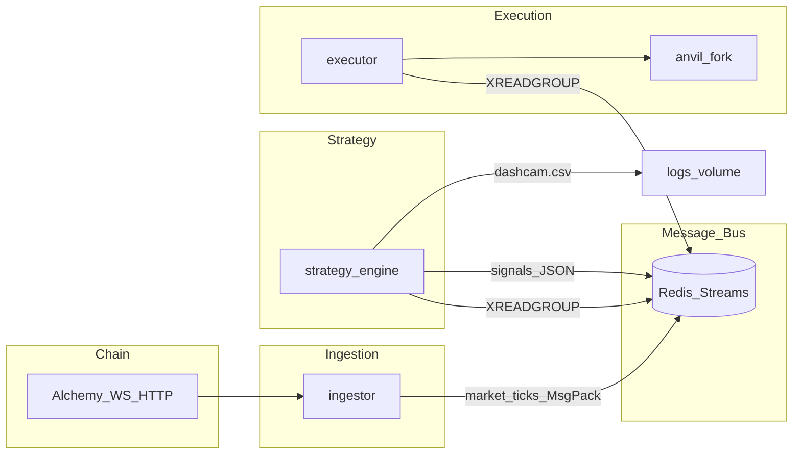
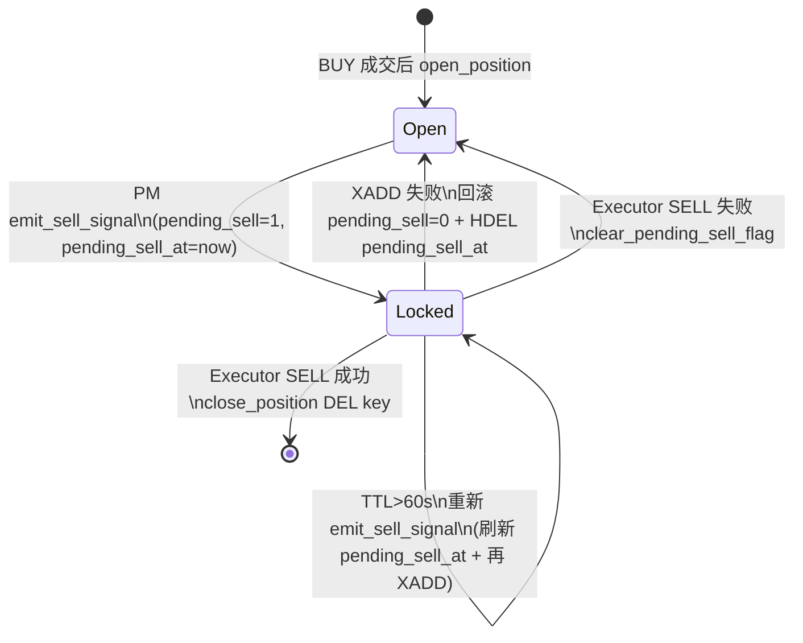

# 架构说明

> **Guard (Phase 3, root canonical):** When this file diverges from whitepaper v2 or legacy diagrams, **`contract docs override narrative drift`**—see `mvp/audits/*.md` plus `docs/*` contracts. **`Rust Sniper` / `rust_executor`** wording is narrative/historical; runtime executor:**`docs/executor-language-contract.md`**. **`fs:` / `feat:`** and four- vs five-feature store:**`docs/model-feature-gap.md`**. ClickHouse/archiver “always-on”:**`docs/architecture-compose-profiles.md`**. **`<20ms` / T+ms** timelines:**`docs/latency-benchmark-plan.md`**—not benchmark-proven. **`FAILED_NO_7D_ALPHA`**:`mvp/audits/failed_no_7d_alpha_guard.md`; reading here is **`not an authorization`** for labeling, training, live, Phase 6, or alignment claims.

**MR 前本地静态契约（无 Docker / 无 RPC）：** 见 `Operations.md` §「仓库静态契约检查」与仓库根目录 `Makefile` 的 `make check-static`（不表示 guard 解除）。

## 总览

## 服务职责

| 服务 | 职责 |
| ---- | ---- |
| **redis-stack** | Streams（`market_ticks`、`signals`）、策略侧 ZSET 特征、部分执行状态 |
| **postgres** | 钱包画像等 OLTP（策略 `_wallet_profile`） |
| **ingestor** | 订阅链上事件，MsgPack 写入 `market_ticks`；依赖 `ALCHEMY_WS_URL`（及可选 fallback） |
| **strategy_engine** | 消费 `market_ticks`，FeatureStore + XGBoost，写 `signals`；高分样本写 `logs/dashcam.csv` |
| **executor** | 消费 `signals`，风控与 swap；纸面连 Anvil，实盘连 `LIVE_BASE_RPC_URL`（compose 服务名 **`executor`**；历史文档与图示亦写 `rust_executor`，**非** Rust-only 承诺，见 guard 与 `docs/executor-language-contract.md`） |
| **anvil** | 本地 fork，供纸面/Paper 模式；`--fork-url` 需有效 `LIVE_BASE_RPC_URL` |
| **dashboard** | Python stdlib HTTP 看板（`services/dashboard/server.py`，读 Redis 实时状态） |
| **pool_discovery** | 发现新池并回填特征；消费 `market_ticks` 用 `data/payload_msgpack/payload/tick` 四路兼容读 |

## Redis Stream 字段约定

权威细节（字段优先级、MsgPack、strategy XACK 卫生）：**`docs/market-ticks-stream-contract.md`**；流滞后 / 死信巡检摘要：**`docs/observability-stream-contract.md`**（非 metrics 后端，仅运维说明）。

- **ingestor → `market_ticks`**：二进制载荷字段名为 **`data`**（MsgPack，LaszLO 契约）。  
- **strategy 消费**：按 **`data` → `payload_msgpack` → `payload` → `tick`** 解析单一 MsgPack 块；字段名可为 bytes 或 str；缺失/坏包跳过处理但仍随批 **XACK**，避免 PEL 堆积（见 contract 文档）。  
- **archiver**（若启用）：与 strategy **相同四字段优先级**（`services/archiver/src/redis_streams.rs`）。  
- **strategy → `signals`**：字段 **`payload`**（JSON 字节），执行器按现有逻辑消费。  
- **executor → `signals_dead_letter`**：当 `signals` 条目缺少 `payload` 或 JSON 解析失败时写入（含 `entry_id` / `error` / `payload`），随后对原消息 `XACK`。  
- **archiver（容错）**：`market_ticks` 若缺少消息块或 MsgPack 反序列化失败，记录告警并 `XACK`，避免消费组 pending 累积。  
- **dashboard 读取兼容**：与 strategy **相同顺序**解析单一 MsgPack 块（`services/dashboard/server.py`）。  

## 执行与持仓状态机（`pending_sell`）

执行器与 `position_manager` 共用 Redis 记录持仓；止损触发的 SELL **不是靠 PM 直接发链上交易**，而是 **向 `signals` 再投一条 SELL**，由 **executor**（历史亦称 `rust_executor`）统一执行，因此需要 **“挂卖锁”** 防止每 2 秒重复风暴，同时在 Executor 断档时能 **超时自愈**。

### `positions:{token}`（Hash）相关字段

| 字段 | 含义 |
| ---- | ---- |
| `entry_eth` / `peak_eth` / `entry_time` / `size_usd` | 持仓估值与计时（PM 侧） |
| `fee_tier` | 本次 BUY 实际使用的 Uniswap V3 费率档（500 / 3000 / 10000），SELL 优先读此字段 |
| `pending_sell` | `1` = 已向 `signals` 发出 SELL，等待链上成交与 Executor 删键；`0` = 未处于挂卖等待 |
| `pending_sell_at` | Unix 秒时间戳；与 `pending_sell=1` 同时写入，用于 **60s TTL** 判断 stale lock |

### 生命周期（摘要）

### 与风控路径的关系（和 `Operations.md` 一致）

- **BUY**：仅在意图买入路径上做流动性（池内 WETH 储备启发式）+ 蜜罐（Quoter V2）等 **pre-trade** 检查；Live 失败偏 **保守拒绝**。  
- **BUY（余额查询）**：`get_balance` 在 Live 下若 RPC 失败，执行器保留 `warn!` 并立即拒绝 BUY（fail-safe）；Paper 可继续用于调试。  
- **SELL**：**不走**上述 BUY 风控，避免在网络/RPC 异常时无法平仓；可先做 `balanceOf(wallet)` 预检，查询失败时 **fail-open** 仍尝试卖出；若余额为 0 则触发 ghost 仓位清理。

### 启动依赖与频控补充（2026-04-17）

- **executor** 在 compose 中依赖 `redis`（及 `anvil`，若启用）的 `service_healthy`，减少 Paper 冷启动阶段的 DNS/连接抖动。
- 执行器的日内回撤检查（`check_daily_drawdown`）已做节流（30s 周期），避免在高频主循环中对 RPC 产生无意义高压调用。

## 离线数据链路

1. `logs/dashcam.csv` ← 策略引擎（`final_score > DASHCAM_THRESHOLD`）  
2. `scripts/prepare_dataset.py` → `logs/dashcam_cleaned.csv`  
3. `scripts/label_dashcam.py`（默认 `LABEL_MAX_AGE_DAYS=30`）→ 合并 `logs/labeled_dataset.csv`  
4. `scripts/retrain_model.py`（训练窗口默认回看 28 天，**holdout 固定最新 7 天**）→ `services/strategy/models/whale_sniper_v2.json` + 阈值元数据（严格门槛未过则不落可部署产物）
5. `scripts/phase6_weekly_cycle.sh`（通过 `scripts/laszlo.sh phase6` 调用）：每周编排 `label → retrain`，配合 cron 使用

## 入口脚本与 ETH 价统一

- 运维唯一入口：`scripts/laszlo.sh`（POSIX bash；子命令 `up/down/restart/status/logs/phase6/maintain`）
- ETH 参考价默认值在 `executor`、`dashboard`、回测脚本间统一为 **3500 USD**；Executor 每 60s 将活跃价写入 Redis key `exec:eth_price_usd`，Dashboard 按 60s 节流读取，保证显示一致

## Redis 键位约定（现役）

| 键 | 类型 | 写入方 | 说明 |
| ---- | ---- | ---- | ---- |
| `market_ticks` | Stream | ingestor / pool_discovery | 字段 `data` = MsgPack dict |
| `signals` | Stream | strategy | 字段 `payload` = JSON 字节 |
| `signals_dead_letter` | Stream | executor | 坏信号记录（含 `entry_id` / `error` / `payload`） |
| `positions:open_pools` | Set | executor | 活跃仓位池地址集合 |
| `positions:{pool}` | Hash | executor / position_manager | 持仓字段（见上表）；`pending_sell` 锁也落此 |
| `positions:realized_pnl:{YYYY-MM-DD}` | String | executor | 当日已实现 PnL |
| `positions:day_start_balance:{YYYY-MM-DD}` | String | executor | 当日起始余额 |
| `feat:flow:{token}` 等 | ZSET/Hash | strategy | FeatureStore 前缀统一为 `feat:`（原 `fs:` 已废弃） |
| `exec:eth_price_usd` | String | executor | 最新 ETH/USD（60s TTL by EX 300） |

## MVP 与 Wiki

- **`mvp/`**：当前实验阶段的检查表、问题队列、周指标（可整目录删除）。  
- **根目录文档**：跨阶段仍成立的说明见 **`Home.md`、本页、`Operations.md`** 等；**不另建 `wiki/` 目录副本**（见 `mvp/audits/documentation_path_map.md`）。