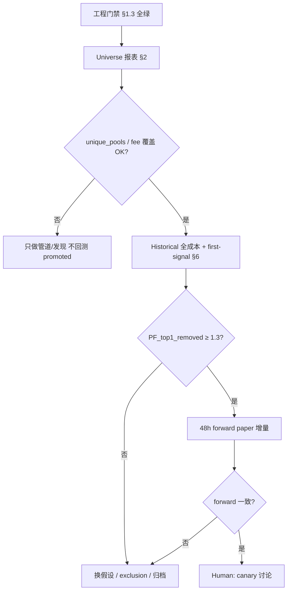

# Alpha Search Sprint SOP — 专注找矿，快速验证

> **Status**: PROVISIONAL_SPRINT (Sprint090+) — **不是永久圣经**  
> **Parent map**: `docs/alpha-sop-decision-tree.md`  
> **Prerequisite audit**: `mvp/audits/sprint090_alpha_search/ENGINEERING_GATE.md`

```text
⚠️ AGENT 必读（每次会话）：
  本文件是「当前冲刺假设」，验证失败 → 删掉过激条款，勿当教条维护。
  成功 → 只把经数据证实的条目沉淀进 alpha-sop-decision-tree.md。
  今天：先猛干验证；别因 SOP 文字拖慢实验。
```

本 SOP 沉淀 2026-05-21 对话中的经验教训：**工程为阿尔法服务**；先证明 universe 足够大，再快速验证、快速迭代。

---

## 0. 一句话原则

```text
工程完工 → 立刻进入阿尔法冲刺 → 禁止积压工程债打断找矿
先证 universe 够大 → 再在宽 fee / 宽池上验证
机会寿命以小时/天计 → 禁止用 7 天 dry run 等短寿池腐烂
回测 = 实盘约束：每池只算第一笔、扣全成本、禁回声 PF
```

---

## 1. 工程 vs 阿尔法：优先级铁律

### 1.1 允许做的工程（P0 管道类）

仅当**阻塞阿尔法验证**时做，做完立刻回到找矿：

| 类别 | 示例 | 完成标准 |
|---|---|---|
| 数据进库 | ingestor / swap-poller / archiver / CH 写入 | 近 1h 有 swap 行、archiver flush、无 PEL 假活 |
| 解码一致 | `0x` 前缀、MV 可达 `uniswap_v3_swaps` | gap/实时行 `length(topic0)=66` |
| 监控 | coverage / CH mutation / archiver watchdog | cron 或告警，不扩新功能 |
| 回填 | gap RPC 回填（一次性） | `gap_backfill_summary.json` 落盘 |

### 1.2 禁止积压的工程债（冲刺期 NO）

```text
❌ 大规模重构、新微服务、文档通胀、无关 dashboard 美化
❌ 「再优化一下」archiver 而推迟 backtest
❌ 等 coverage 95% 才允许跑第一版 alpha（先证 universe 规模，再追覆盖率）
❌ 为通过 gate 而改 onset / 去掉 first-signal-only（那是回声阿尔法）
```

### 1.3 工程完工门禁（开始找阿尔法的前置条件）

全部 ✅ 后才进入 §2–§8 的 alpha 工作。详见 `mvp/audits/sprint090_alpha_search/ENGINEERING_GATE.md`。

```text
[ ] archiver / ingestor / swap-poller healthy ≥ 几小时
[ ] uniswap_v3_swaps 日级 unique pools 趋势向上（目标：200+ active pools/day，方向对即可）
[ ] gap 历史已 materialize 或 MV 自动写入正常
[ ] real_cost_model + QuoterV2 历史块可调用
[ ] sprint088/089 脚本可跑通（discover → quote → exit）
```

---

## 2. Universe 优先：先证「池子够大」，再在矿里挖

### 2.1 错误顺序（禁止）

```text
在 14–20 个池 / 单一 fee tier 上调参 → 宣称 PASS → 上 live
```

这是**小样本幻觉**，不是普遍性证明（Sprint088 已证：top1 去掉后 PF 0.19）。

### 2.2 正确顺序（必须）

```text
1. 度量 universe：日活 WETH-leg pools、30d 去重池数、按 fee_bps 分层计数
2. 未达标 → 只做工管道/发现（factory ingest、swap-poller 宽度），不做策略 promoted
3. 达标 → 在宽 universe 上跑 historical + 短窗口 forward
```

### 2.3 Universe 最低研究门槛（Adaptive，本轮建议）

| 指标 | 研究门槛 | 说明 |
|---|---|---|
| `unique_pools`（回测窗） | **≥ 30** | Sprint087/088 硬门槛 |
| `unique_pools`（理想） | **≥ 50–200** | 接近「日活 200+ pool/day」方向 |
| `top_pool_share` | **≤ 0.15** | 防单池带飞 |
| fee tier 覆盖 | **≥ 2 档有 n≥5** | 禁止「54 笔全在 10000」仍称 general alpha |
| 日活池（CH） | **趋势 ≥ 50/day → 200/day** | 管道健康，非策略 gate |

### 2.4 数据范围工程要点（已完成方向，勿回退）

- ingestor：**factory-only** `LOG_FILTER`（PoolCreated），非 10 池白名单  
- swap-poller：Redis `discovered_pools` 全量 WETH-leg + blue-chip  
- gap backfill：写 `raw_evm_logs` 必须 **0x 前缀**（`sprint089_pipeline_gap_backfill.py`）

---

## 3. Fee tier（gas 档位）：universe 要宽，高成本单要 pass

### 3.1 原则

```text
Universe 选择要宽广：fee_bps ∈ {100, 500, 3000, 10000} 都要能进样本池
策略层可以 PASS 高 gas / 低净边际的单 — 但不能在数据层就把高档位删光
```

### 3.2 执行

| 层 | 做法 |
|---|---|
| **数据** | 不按 fee 预过滤 ingest；`discovered_pools.fee_bps` 仅用于事后分层 |
| **研究** | `by_fee` 表 mandatory；任一档 n=0 须在 readout 标 **FEE_BLIND_SPOT** |
| **执行** | QuoterV2 多 tier 报价（3000→10000→500）；`real_cost_model` 含 gas + 滑点 |
| **PASS 高 gas** | 净收益 after all costs ≤ 0 → `HARD_PASS`（不进信号），但保留在 universe 统计 |

### 3.3 禁止

```text
❌ 只在 fee=100 或 fee=10000 上挖到 PASS 就推广为「全链 alpha」
❌ 用 narrowing fee 换 PF 数字
```

---

## 4. 阿尔法衰减极快：快速验证，禁止「等 7 天」

### 4.1 机会寿命分类

| 类型 | 典型寿命 | 验证方式 | 禁止 |
|---|---|---|---|
| **短寿池** | 数小时–3 天 | 历史 replay + **24–48h** forward paper | 7d dry run / 7d 等 forward |
| **中寿** | 3–14 天 | 历史 14–30d + 48h forward | 无成本 gross PF 宣称 |
| **慢窗口** | 周级 | 可 scoped shadow 更长 | 用慢窗口标签回灌 5m 入场 |

### 4.2 时间预算（Sprint090 默认）

```text
Historical backtest（全成本）     : 当天出 verdict
Forward paper shadow             : 24–48h 增量 N，不是 7d
Pipeline 稳定观察               : 并行，不阻塞 historical
Promotion / canary               : 仅 historical + forward 双过 adaptive gate + PF top1-removed
```

### 4.3 与 FAILED_NO_7D_ALPHA 的关系

- **研究冲刺**：本 SOP 允许 **不等 7 天** 就做 historical / 48h forward。  
- **晋升 live**：仍遵守 `docs/phase6-resolution-criteria.md`（≥7d 等硬条件），**不得**用本文件绕过。

---

## 5. 做市商 / 污染钱包：禁止准入 + 反向验证

### 5.1 Hard rule

```text
单一做市商 / 公共 router / 已知污染 sender 不得作为「alpha 主体」
若某 sender 在 >X% 盈利信号中出现 → 触发 F3 污染审查
```

### 5.2 必做对照实验（Sprint086 延续）

| 实验 | 做法 |
|---|---|
| **Exclude 0x6ff5** | 默认 `exclude_0x6ff5=True`（onset 层） |
| **Reverse filter** | `WEATHERVANE_0X6FF5_REVERSE_FILTER_OPEN`：作 exclusion，不作 directional alpha |
| **Exclude top sender** | 报告 PF / WR **with vs without** top1 sender |
| **Router / toxic** | `toxic_filter` + `mev_blacklist.yaml` |

### 5.3 Readout 必报

```text
pf_all, pf_exclude_top1_sender, pf_exclude_0x6ff5
win_rate 同上
若 exclusion 后 PF 上升 → 污染确认，策略必须带 exclusion gate
```

---

## 6. Cooldown 与 First-Signal-Only：禁回声阿尔法（Echo Alpha）

### 6.1 实盘约束

```text
真实资金有限 → 同一 pool 在实盘窗口内最多执行 FIRST entry 一笔
后续 heat 再亮 → 忽略（cooldown），不得重复下单
```

### 6.2 回测必须镜像实盘

| 规则 | 实现 |
|---|---|
| **First-signal-only** | 每 `pool_address` 全回测窗 **最早** 一个 qualifying onset |
| **Cooldown** | 入场后 `COOLDOWN_SEC`（默认 ≥ 池 max age 或 24h）内不再计新信号 |
| **禁止** | 同一池多笔计入 PF、n、win_rate |

### 6.3 PF 完整性 gate（强制报告）

```text
PF_overall
PF_top1_trade_removed      # 单笔去掉
PF_top1_pool_removed       # 单池去掉
bootstrap PF 5th percentile
```

**PASS 条件（研究）**：`PF_top1_removed ≥ 1.3` 且 `unique_pools ≥ 30`（Sprint088 VERDICT）。

### 6.4 与 Sprint086/088 对齐

-  loosening `onset_thresh` **只为刷 n** = 重新引入 echo alpha → **禁止**  
- 30d 放宽 lookback / pool_max_age 可接受，但必须保留 first-signal-only

---

## 7. 退出策略与全成本（白皮书 + real_cost）

### 7.1 成本栈（缺一不可）

```text
买入滑点（QuoterV2 @ entry_block）
卖出滑点（QuoterV2 @ exit blocks）
卖出失败 / honeypot（sell_fail_rate）
gas（Base L2，按 entry/exit tx 计）
per_leg_cost_pct（默认 1.2% 或 charter 实测）
```

权威实现：`scripts/lib/real_cost_model.py` + `sprint088_historical_backtest.py`

### 7.2 退出策略（当前候选）

```text
Policy: trailing_5_pull3_2h（白皮书 Sprint086 批次）
TP1 +5% (30%), TP2 +15% (30%), trailing pull 3%, SL -10%, time stop 2h
```

任何新 alpha **不得**用 gross return 或 observation price 宣称 PASS。

### 7.3 Readout 必报

```text
mean_return (net), win_rate, PF, sell_fail_rate, honeypot_rate
n_decidable vs n_skipped_buy_quote_fail
```

---

## 8. 冲刺工作流（Agent / 人类）



### 8.1 每轮 sprint 交付物

```text
mvp/audits/sprintXXX_<name>/
  UNIVERSE_REPORT.md      # 池数、fee 分布、日活趋势
  readout.md              # PF / WR / exclusion 对照
  per_signal.csv          # 可审计
  VERDICT.md              # PASS/FAIL + 是否 echo/outlier
  decision_flags.json     # TRAINING_ALLOWED, LIVE_ALLOWED
```

### 8.2 注册

新 sprint 行写入 `mvp/audits/alpha_registry.md`，`family` 标注 F1–F7。

---

## 9. 当前已知陷阱（2026-05-21）

| 陷阱 | 症状 | 动作 |
|---|---|---|
| 管道断流 | 日活 10–20 pools | 先 Sprint089 P0，不跑 promoted backtest |
| MV 丢行 | gap 无 0x | 已修脚本；历史用 `backfill-sprint089-gap-swaps.sql` |
| Echo PF | 高 PF + 低 WR | PF_top1_removed + first-signal-only |
| 单 fee tier | 全 10000 | 标 FEE_BLIND_SPOT；扩 discovered_pools 元数据 |
| 7d 等待 | 池 3 天死亡 | 改 48h forward（§4） |
| MM 污染 | 0x6ff5 / top sender | exclusion 对照（§5） |

---

## 10. 相关脚本与路径

| 用途 | 路径 |
|---|---|
| Historical backtest | `scripts/sprint088_historical_backtest.py` |
| Real cost | `scripts/lib/real_cost_model.py` |
| Gap backfill（0x 前缀） | `scripts/sprint089_pipeline_gap_backfill.py` |
| Gap → swaps SQL | `scripts/backfill-sprint089-gap-swaps.sql` |
| Coverage monitor | `scripts/sprint089_pipeline_coverage_monitor.py` |
| 30d 放宽 run | `mvp/audits/sprint088_historical_backtest_30d/` |
| 管道恢复 | `mvp/audits/sprint089_pipeline_recovery/` |
| 决策树父文档 | `docs/alpha-sop-decision-tree.md` |

---

## 11. Changelog

| Date | Change |
|---|---|
| 2026-05-21 | v1 — Sprint090 用户经验教训首版入库 |
