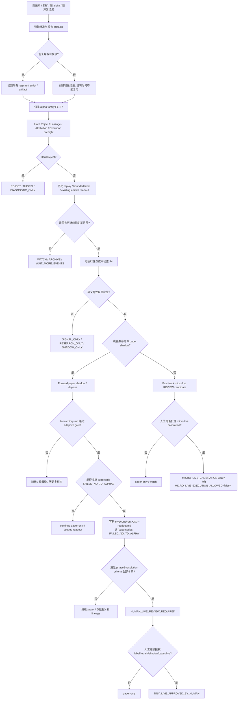
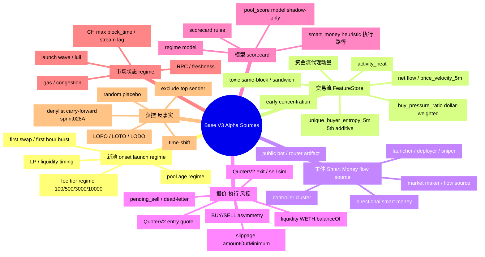
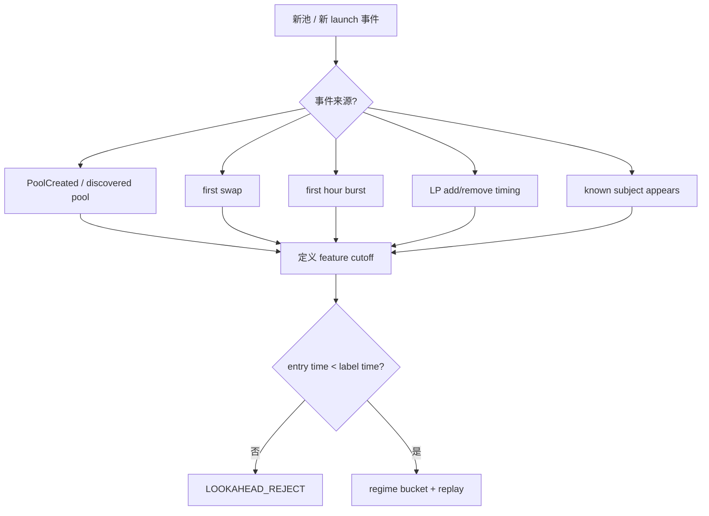
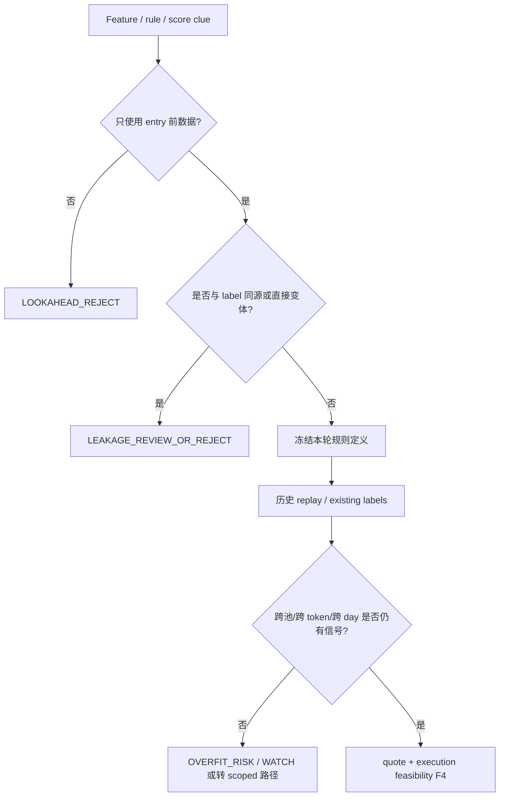
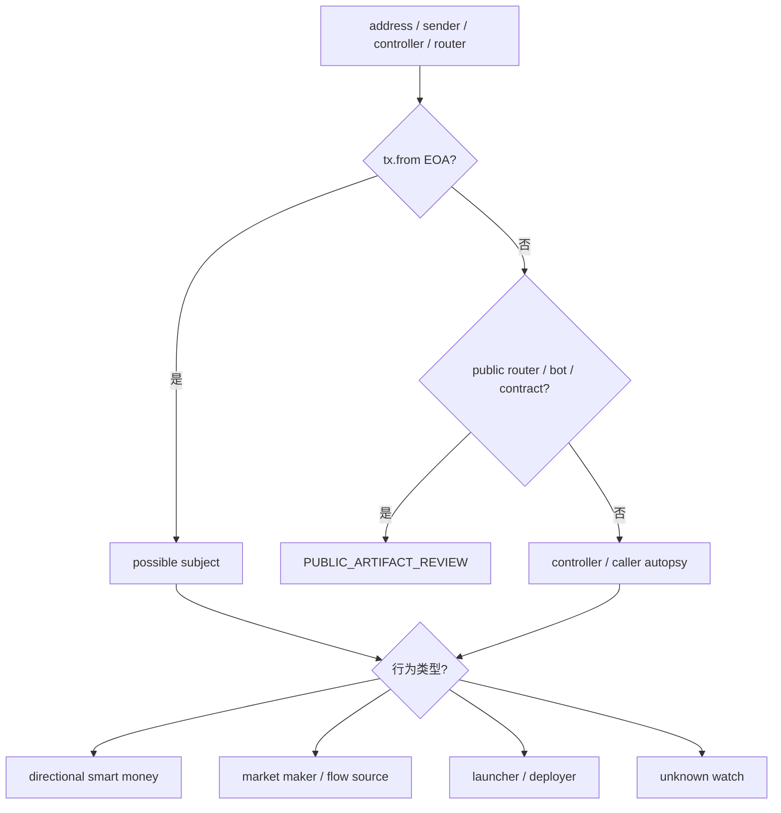
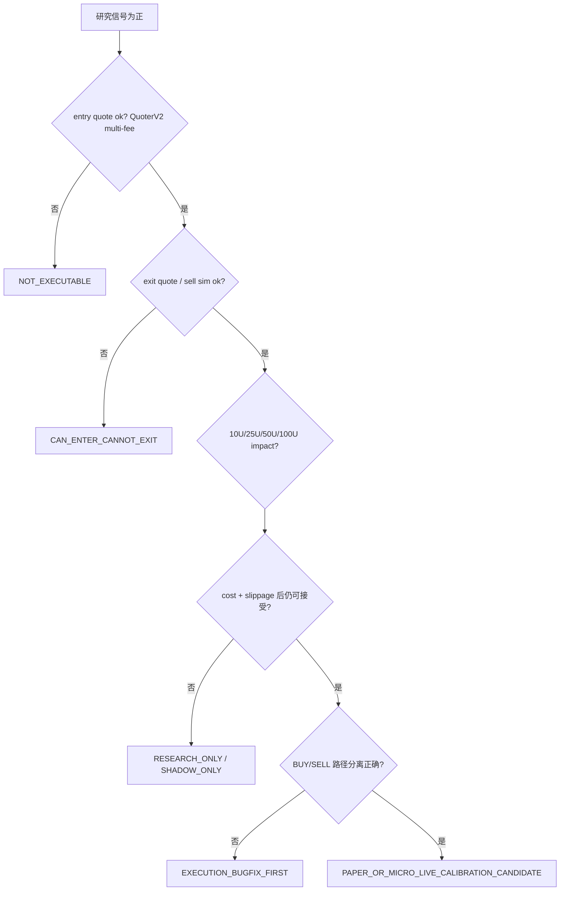
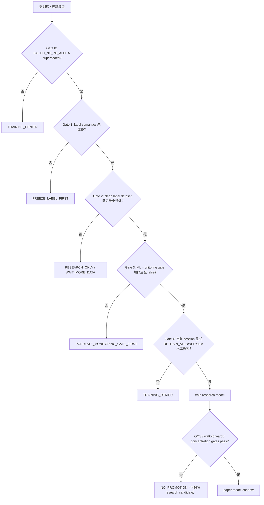
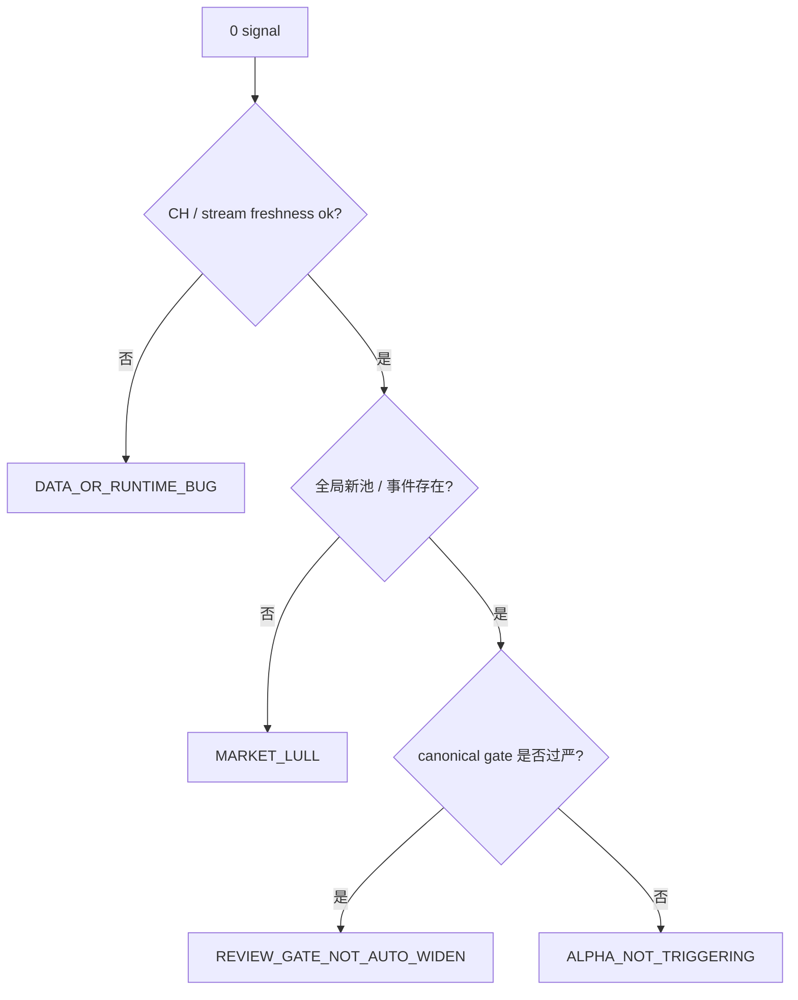

# Alpha SOP Decision Tree — Base V3 主线（canonical）

> **用途**：把 EATLQ / LASZLO 项目多轮 Agent 对话挖出的 alpha 线索、验证链路、执行 gate、失败原因和下一步动作沉淀成一张**矿山地图**。本文件是**地图，不是宪法**——可执行硬契约仍以仓库源码与 `docs/` 下既有契约文档为准。
>
> **来源整合**：本版 v1 取代 `/root/alpha_sop_decision_tree_basev3_v1_draft.md`（v0 在仓库内不存在；本版以 v1 draft 为种子，按仓库实际契约 patch）。
>
> **生效范围**：Base L2 / Uniswap V3 主线。BNB / Monad / Uniswap V2-only / Uniswap V4 / Aerodrome 仅作为「out-of-scope external extension」，不污染主树（见 §17）。

---

## 0. 本版定位

### 0.1 核心目标

1. 防止多轮 Agent 对话中的有用矿丢失。
2. 让每个新 alpha 线索先归类，再进入对应验证链路。
3. 把「能不能继续挖、怎么继续挖、何时降级、何时小额验证」写成可执行决策树。
4. 在不制造文档通胀的前提下，保留足够证据让后续 Agent 接上上下文。
5. 保持原作者主线精神：链上事件 → 特征/模型 → 信号 → 报价/执行 → 风控/退出 → 复盘闭环。

### 0.1b Alpha Search Sprint（冲刺期执行宪法）

**Sprint090+ 找矿阶段**以 `docs/alpha-search-sprint-sop.md` 为准，优先级高于本决策树中的「默认 7d paper」叙事当两者冲突时：

- 工程债不积压；管道完工后立刻验证 alpha  
- Universe / fee tier 先证够大，再调策略  
- 短寿池禁止 7d dry run；用 historical + 48h forward  
- First-signal-only + cooldown；禁回声 PF；全成本退出  
- 工程门禁：`mvp/audits/sprint090_alpha_search/ENGINEERING_GATE.md`

### 0.2 来源优先级（冲突时）

```text
1. 当前仓库源码与可运行脚本（services/ingestor, services/strategy, services/executor, scripts/）
1b. docs/alpha-search-sprint-sop.md（冲刺期；与 8 冲突时用于研究节奏，不绕过 phase6）
2. Architecture.md / Operations.md / AGENTS.md / Home.md
3. docs/*-contract.md / docs/*-freeze.md / docs/*-gate.md / docs/phase6-resolution-criteria.md
4. mvp/audits/*.md（含 FAILED_NO_7D_ALPHA guard、whitepaper_v2_contract_index.md）
5. mvp/runs/*.md（已落盘 readout，含 supersession 链）
6. whitepaper-v2.md / Whitepaper-v2-continued.md（叙事；与代码冲突以代码为准）
7. Whitepaper-v1-continued.md / docs/whitepaper-v1-original.md（仅历史蓝图）
8. 本 SOP（决策地图层）
```

### 0.3 默认范围

```text
DEFAULT_CHAIN         = Base L2 (chain_id = 8453)
DEFAULT_DEX           = Uniswap V3（label freeze 含 v2,v3；aero_cl / aero_vamm / V4 out-of-scope）
DEFAULT_EXECUTION     = services/executor/src/main.py + swap.py，exactInputSingle，QuoterV2 quote
DEFAULT_DATA          = services/ingestor → market_ticks (MsgPack data) → services/strategy → signals (JSON payload)
DEFAULT_LABELER       = scripts/label_dashcam_executable.py（exit horizon 1800s frozen）
DEFAULT_RETRAINER     = scripts/retrain_model.py（28d 训练 + 7d holdout）
DEFAULT_SAFETY        = paper-first；FAILED_NO_7D_ALPHA 未 superseded 前不允许 promote
DEFAULT_FEATURE_PREFIX= feat: （whitepaper 叙事 `fs:` 已废弃；见 docs/model-feature-gap.md）
```

### 0.4 当前 guard 状态（最新需 Agent 复核 `mvp/audits/failed_no_7d_alpha_guard.md`）

```text
FAILED_NO_7D_ALPHA_ACTIVE              = true
LABELING_ALLOWED                       = false
TRAINING_ALLOWED                       = false
RETRAIN_ALLOWED                        = false
LIVE_ALLOWED                           = false
PHASE6_ALLOWED                         = false
WHITEPAPER_ALIGNMENT_CLAIM_ALLOWED     = false
MICRO_LIVE_CALIBRATION_CHARTER_ALLOWED = true   # 仅 charter / 估算
MICRO_LIVE_EXECUTION_ALLOWED           = false  # 不允许真金执行
ACTIVE_UNIVERSE_MINING_ALLOWED         = true
SMART_MONEY_AS_INPUT_OR_DIAGNOSTIC     = true
SMART_MONEY_GENERAL_LINE_OPEN          = false
WALLET_DIRECT_COPY_OPEN                = false   # Route A closed (Sprint083)
WALLET_CONDITIONED_RESEARCH_OPEN       = true    # Route C research allowed (Sprint085)
WALLET_CONDITIONED_LIVE_ALLOWED        = false   # Route C live requires human gate
REAL_COST_OVERLAY_REQUIRED             = true    # Sprint086: paper PF claim must cite *_real PF
PAPER_PF_WITHOUT_REAL_COST_VALID       = false   # Gross PF no longer counts for promotion
BATCHED_EXIT_RESEARCH_OPEN             = true    # Sprint086 trailing 2h shows PF 1.6-1.8 candidate
WEATHERVANE_0X6FF5_DIRECTIONAL_OPEN    = false   # Sprint086: hypothesis falsified at n=55 (40% honeypot)
WEATHERVANE_0X6FF5_REVERSE_FILTER_OPEN = true    # Sprint086 next step: test as exclusion signal
```

---

## 1. 三层 gate 框架

不把所有条件写成「死黑名单」。本 SOP 把判定分三层：

### 1.1 Hard Reject Gate（命中即拒绝或修 bug）

```text
LOOKAHEAD_USED                                = true
FUTURE_PRICE_OR_QUOTE_USED_AS_ENTRY_FEATURE   = true
HISTORICAL_PNL_USED_AS_ENTRY_FEATURE          = true
LABEL_LEAKAGE_INTO_FEATURE                    = true     # 见 docs/label-semantics-freeze.md
POOL_OR_TOKEN_OR_TX_HASH_AS_PREDICTIVE_FEATURE= true     # 见 sprint028c §3 forbidden
PRIVATE_KEY_OR_RPC_SECRET_WRITTEN_TO_REPO     = true     # 见 AGENTS.md "out of bounds"
LIVE_WITHOUT_HUMAN_APPROVAL                   = true
PRODUCTION_SIGNAL_WRITTEN_BY_RESEARCH_TASK    = true     # 见 docs/signal-path-contract.md
POOL_SCORE_WRITTEN_TO_signals_STREAM          = true     # 必须只能写 shadow:signals
LIVE_TRADING_MODE_AND_EXECUTOR_DRY_RUN_BOTH_TRUE = true  # executor 拒绝启动
CAN_ENTER_BUT_CANNOT_EXIT                     = true
UNKNOWN_PUBLIC_ROUTER_TREATED_AS_SMART_MONEY  = true
SINGLE_POOL_OR_SINGLE_SENDER_RESULT_CLAIMED_AS_GENERAL_ALPHA = true
BATCH_RPC_FOR_PER_ROW_QUOTE                   = true     # 见 docs/label-semantics-freeze.md
LABEL_SEMANTICS_DRIFT                         = true     # exit horizon ≠ 1800s 等
PROMOTION_BASED_ON_MODEL_METRICS_ALONE        = true     # 不能 supersede FAILED_NO_7D_ALPHA
```

### 1.2 Review Gate（不拒绝，但必须标风险并降级 / 缩量 / 加 control）

```text
LOW_SAMPLE_SIZE
HIGH_POOL_CONCENTRATION                       # top1 / top5 占比超阈
HIGH_TOKEN_CONCENTRATION
HIGH_SENDER_DEPENDENCY                        # 单 sender 带飞
UNSTABLE_ACROSS_DAYS / LOO_UNSTABLE
QUOTE_DEGRADED_BUT_NOT_ZERO
GAS_PATTERN_MISMATCH_WITH_AUTHOR_CANON        # 风险标记，非一刀切
SHORT_LIVED_OPPORTUNITY                       # 无法做 7d paper shadow
FAST_IN_FAST_OUT_SUSPECT                      # toxic_filter <60s
SAME_BLOCK_SANDWICH_SIDE                      # toxic_filter
SHADOW_CONFIDENCE_BAND_NARROW                 # 见 mvp/issues.md I-002
```

Review gate 的作用是降级、缩 notional、进 paper-only 或 charter-only，而不是自动否决。

### 1.3 Adaptive Gate（由 Agent 按现有数据动态定义）

适用于：训练样本量、天数、池数、forward shadow 时长、PF/WR 阈值、cost-adjusted 净收益门槛。**不得机械写死「必须 14 天 / 50 池 / 500 trades」**；Agent 应根据 alpha 类型、样本密度、机会寿命、执行成本给出本轮门槛并解释。

> **关键约束**：adaptive gate 可决定本轮**研究**门槛；但**「跨过 FAILED_NO_7D_ALPHA 进入 promotion / live」永远不是 adaptive**——必须满足 `docs/phase6-resolution-criteria.md` 全部六条（新 readout + 显式 supersession 行 + 正 holdout 经济 + ≥7d + label/monitoring lineage + 不靠 model metrics）。

---

## 2. 总状态机



---

## 3. Alpha family 主树

本版聚焦 Base V3，但保留足够宽的 alpha 来源，防止矿被漏掉。



---

## 4. Canonical Base V3 特征 anchors

### 4.1 原作者核心经验（永不丢失）

DEX 小币价格容易失真，单笔价格、虚假成交、同区块刷量、做市商原价进出都可能污染直接价格信号。Base V3 主线**默认优先看 5 分钟窗口内的资金流方向与持续买压**，而不是盲信单笔价格。这是「资金流代理动量」的来源（见 `whitepaper-v2.md` §3.3、`docs/model-feature-gap.md`）。

### 4.2 Canonical anchors（与代码对齐，来源 `services/strategy/src/feature_store.py`）

| feature | 默认含义 | 来源 | 主要风险 |
|---|---|---|---|
| `price_velocity_5m` | 净资金流 / 总绝对流 ∈ [-1, 1]；同 block 内 `(sender, block)` 净额合并 | feature_store.py | 小样本、同主体刷量 |
| `buy_pressure_ratio` | **$ 加权**买入额占比（线上/离线统一到成交量口径） | feature_store.py | wash buy、router 混淆 |
| `token_volatility_5m` | 规模变异系数（cap 2.0） | feature_store.py | 早期爆发误杀 |
| `activity_heat` | 5m 窗口 tick / swap count | feature_store.py | public bot 噪音 |
| `unique_buyer_entropy_5m` | 买方分布熵；**5th additive**，向后兼容 4 维模型 | feature_store.py | 见 `docs/model-feature-gap.md` MM-05 |

**Stable phrase**：`unique_buyer_entropy_5m` 是 additive 第 5 维，不在 whitepaper 原始 4 维集合；不要为「白皮书一致」改名 `fs:`，实际前缀为 `feat:`。

### 4.3 Toxic-flow 链路 anchors（2026-04 加固，`services/strategy/src/toxic_filter.py` + `infra/config/mev_blacklist.yaml`）

```text
(tx_hash, log_index)              去重
<60s 快进快出地址                  打入 toxic 集
同 block sandwich 侧地址           打入 toxic 集
strategy / wallet scorer / meme scorer 统一读取 mev_blacklist.yaml 并扣除
STRATEGY_USE_CALIBRATED=1          可选加载 *_calibrator.pkl
*_threshold.json > *_metrics.json.ev_threshold
```

### 4.4 扩展 feature 的准入规则

任何新 feature 必须在 registry（§13）中标注：

```text
feature_name
source_table_or_stream
cutoff_time
uses_future_info     = true / false
same_source_as_label = true / false
intended_use         = entry / guard / diagnostic / attribution / training_only
known_failure_modes
```

---

## 5. Family F1 — 新池 / Onset / Launch Regime

### 5.1 入口



### 5.2 必须拆分的 regime

| 维度 | buckets |
|---|---|
| fee | 100 / 500 / 3000 / 10000 |
| age | 0–5m / 5–15m / 15–30m / 30–180m / 180m–24h |
| heat | low / medium / high / decay |
| buyer structure | single actor / diverse buyers / bot-dominated |
| quote health | quoteable / degraded / unquoteable |
| liquidity | too shallow / tradable tiny / tradable small / deep enough |
| subject presence | none / known flow source / public bot / unknown |

### 5.3 判定

```text
PASS_CANDIDATE: 多池/多天或合理 subject-family 支撑，且 quote/execution 成立
WEAK_PASS:      明显正信号但样本少 / 集中度高 / 只适合 tiny test
WATCH:          市场事件不足或样本未发育
REJECT:         lookahead / 不可 quote / 不可 exit / 单池幻觉
```

---

## 6. Family F2 — 交易流与 FeatureStore Alpha

### 6.1 验证树



### 6.2 反过拟合 control（与 F7 共用）

```text
LOPO = leave one pool out
LOTO = leave one token out
LODO = leave one day out
exclude_top_sender / exclude_top_pool / exclude_top_token
time_shift_placebo / random_negative_control
same_family_duplicate_check
denylist_carry_forward（sprint028A/028 family，禁止重新撞坏池）
```

### 6.3 允许「非普适 alpha」存在

如果特征只在某类 launch regime / fee / subject presence 下有效，**不要强行否定**。降级为：

```text
REGIME_SPECIFIC_ALPHA / SUBJECT_CONDITIONED_ALPHA
DIAGNOSTIC_GUARD / SHADOW_ONLY_CLUE
```

按 `mvp/audits/sprint028c_scoped_micro_alpha_policy.md` §1.1 的**两轨**框架处理：scoped 轨不被 top1/top5/LOO 自动否决，但仍需 within-pool temporal + walk-forward + cost-adjusted net PnL。

---

## 7. Family F3 — 主体 / Smart Money / Flow Source

主体类**不删**，但**不喧宾夺主**。它是独立矿脉，可作为 direct-follow、onset signal、regime signal 或 contamination exclusion。

### 7.1 主体识别入口



### 7.2 Directional Smart Money — 验证集

```text
self_pnl_positive
post_observation_follow_pnl_positive
delay_1_block / delay_30s / delay_1m still viable
not_public_bot（router 不算 smart money）
active_recently
not_single_token_only
quote_feasible_at_target_notional（10U/25U/50U）
not_in_mev_blacklist.yaml
not_in_toxic_filter_set
```

输出标签：

```text
SUBJECT_STATUS = DIRECTIONAL_SMART_MONEY / FLOW_SOURCE / PUBLIC_ARTIFACT / WATCH_ONLY
COPYABILITY    = DIRECT_COPY / WINDOW_COPY / TOO_LATE / NOT_COPYABLE
USE_MODE       = DIRECT_FOLLOW / ONSET_SIGNAL / REGIME_SIGNAL / EXCLUDE_CONTAMINATION
```

### 7.3 Market Maker / Flow Source — 不要问「它买什么我买什么」

先问：

```text
它出现后，5m / 15m / 30m / 60m 窗口是否形成可交易波动？
它是制造噪声，还是标记真实 launch regime？
直接跟单是否慢半拍？
把它作为条件变量后，FeatureStore 信号是否更清晰？
```

### 7.4 与策略路径的绑定

- `smart_money` 是**可执行**信号路径（写入 `cfg.signal_stream`），但 **executable ≠ live authorized**（`docs/signal-path-contract.md`）。
- `pool_score` 路径**只能写 `shadow:signals`**；改写主流由 `tests/test_whitepaper_v2_static_contracts.py::test_signal_path_boundary_is_static` AST 静态拦截。

### 7.5 F3 路径三分（生效）

自 Sprint083 封档 + Sprint085 重启起，Family F3 主体行为**必须**按以下三条路径分流，禁止混用：

| Route | 名称 | 状态 | 证据 / 入口 |
|---|---|---|---|
| **A** | `DIRECT_SMART_MONEY_COPY` | **CLOSED** | `mvp/audits/sprint083_fee500_paper_shadow/v3_mainline_decision_flags.json` (`SMART_WALLET_DIRECT_COPY_STATUS=REJECT_NOT_COPYABLE`, `COPYABILITY_LINE_CLOSED=true`); closure artifact: `smart_wallet_copyability_closure.md` |
| **B** | `WALLET_DIAGNOSTIC_AND_CONTAMINATION_GUARD` | **KEEP_ACTIVE** | sender-exclusion controls (alpha_029–038); `is_0x6ff5` onset presence (alpha_009); router/public-bot artifact review; CH `038_recipient_profile_views.sql` (diagnostic only) |
| **C** | `WALLET_CONDITIONED_POOL_ENTRY_MODEL` | **RESTART_AS_SPRINT085** | Strategic charter: `docs/wallet_conditional_pool_entry_model_v0.md`; workspace: `mvp/audits/sprint085_wallet_conditional_entry/` |

**Route A 规则：** 禁止以历史 ROI / top wallet rank 作为 entry alpha；禁止重启 `sprint049c_copy_follow_sidecar.py` 作为主线；除非出现**新的 forward-only 证据**并经 human gate 显式 supersede Sprint083 closure，否则不得 reopen。

**Route B 规则：** 钱包特征仅作 diagnostic / guard / contamination exclusion，服务 F1 onset 与 F2 FeatureStore；**不得**单独 promote 为 executable entry signal。

**Route C 规则：** 样本粒度 = candidate trade（非 wallet-level aggregate）；必须含 failure 样本、rolling freeze-time OOS、delay-adjusted + size-adjusted labels；promotion 路径 = Phase 1 OOS → Phase 3 paper shadow（**新增** cron，不替换 sprint055/068）→ Phase 4 dry-run → `READY_FOR_HUMAN_LIVE_REVIEW`；`WALLET_CONDITIONED_LIVE_ALLOWED` 保持 false 直至 human 批准。

**与主线关系：** Route C 叠在 Sprint084 pool-entry quality 之上，不抢 sprint055/068/069/077 forward 资源；上述 shadow / dry-run **必须保持运行**。

### 7.6 Sprint086 — Real-cost overlay 强制门（生效）

自 Sprint086（2026-05-20）起，**任何 paper shadow / dry-run readout 引用 PF/WR/mean return 做 promotion 论证时，必须同时引用 `*_real` 列**（来自 `scripts/lib/real_cost_model.py` 经 `scripts/sprint086_cost_overlay.py` 叠加）。

| 行为 | 规则 |
|---|---|
| 论证一条 alpha 应当 promote 到 dry-run / canary | **必须**引用 `net_return_{h}_real` 而非 `net_return_{h}` 或 `net_return_{h}_ag` |
| paper shadow CSV 已存在 `net_return_{h}_ag` | `_ag` 只扣 0.2% gas，**不替代** `_real`（不含 slippage / honeypot / 卖出失败）|
| 历史 backtest（>7 天前的信号） | **必须**用 `--block-snapshot` 历史块报价；`latest` 块仅用于"今天还能不能卖"的存活诊断 |
| `sell_path_ok=False` 或 `honeypot_flag=True` 的行 | 该笔记为 -100%；任何 PF 计算不得 silently 跳过它们 |
| `rpc_error=True` 的行 | 从 PF 计算中排除（不算赢也不算输）；`rpc_error_rate` 必须随 PF 一起报告 |
| 新增 paper shadow / dry-run 脚本 | **必须** import `scripts.lib.real_cost_model` 并在每笔信号写出 `*_real` 列；禁止只写 `*_ag` |
| Backwards-compat | 现有 sprint055/068/069 cron 不变；overlay 用 post-processor 形式补成本 |

**对应 guard：**
```
REAL_COST_OVERLAY_REQUIRED              = true
PAPER_PF_WITHOUT_REAL_COST_VALID        = false
```

**首次执行 readout：** `mvp/audits/sprint086_real_cost_overlay/FULL_EXECUTION_READOUT.md`（三条主 alpha 历史块口径 real PF 2.0-2.3；`trailing_5_pull3_2h` PF 1.6-1.8 候选；0x6ff5 weathervane 在 n=55 否定）。

---

## 8. Family F4 — 报价 / 执行 / 风控

### 8.1 执行可行性树



### 8.2 Base-V3-specific execution checks（与 `docs/executor-language-contract.md` / `Architecture.md` 对齐）

```text
chain_id = 8453（live）；不匹配 → 跳过 + XACK，不入 dead-letter
LIVE_TRADING_MODE 与 EXECUTOR_DRY_RUN 不能同时为真（fail-safe，拒绝启动）
exactInputSingle 路径 + amountOutMinimum / slippage cap
QuoterV2 entry + exit 多 fee tier（3000 → 10000 → 500）
fee_tier 写入 positions:{pool} hash；SELL 必须读同一档
BUY 风控：流动性 WETH.balanceOf(pool)、honeypot QuoterV2 sell sim、daily drawdown
BUY 余额查询 Live RPC 失败 → fail-safe 拒绝；Paper 可继续
SELL 风控：不走 BUY 风控；balanceOf=0 → ghost 仓位清理
pending_sell / pending_sell_at（pool-keyed positions:{pool}，60s TTL，stale lock 自动重发）
signals 字段：payload (JSON 字节) 优先；signal_json legacy
signals_dead_letter error 分类：parse_failed / buy_missing_pool_or_token /
                              buy_invalid_pool_or_token_address / handle_failed:*
action 严格大小写：仅 ASCII "BUY" 触发执行；其他 skip + XACK（不进 dead-letter）
signal_source = pool_score 跳过执行（shadow-only）；smart_money 才进可执行
confidence 低于 SIGNAL_MIN_CONFIDENCE（默认 0.52）→ skip + XACK
SYSTEM_PANIC（默认键名）触发 → strategy 停发 + executor 停下单
```

### 8.3 成本拆分（禁止混淆）

```text
fixed_cost_per_trade_U
percent_cost_per_trade
gas_cost_U
slippage_cost_U
missed_entry_cost
failed_exit_cost
ROUND_TRIP_COST = 0.006（label freeze 用；研究/纸面比该值再宽松属"乐观假设"必须标注）
```

禁止把 `0.02U` 固定成本与 `2%` 百分比成本混成同一个数。

### 8.4 已知历史风险残值（`Code-Review.md`）

- `ETH_PRICE_USD` 运行期不自动刷新 → 由 executor 60s 写 `exec:eth_price_usd`；研究脚本如果不读该键会和实盘漂移。
- ingestor 429 → 没有 `market_ticks` 即等于「0 signal 假象」，必须先查 stream freshness（F6）。
- pool_score 永远禁止直接写 `signals`（AST 静态测试拦截）。

---

## 9. Family F5 — 模型 / XGBoost / Scorecard

### 9.1 训练前置条件（按 `docs/ml-training-gate.md` Gate 0–4）



### 9.2 动态训练门槛（Agent 必须解释本轮门槛，禁止机械写死）

```text
research_probe:        样本可小，但只能叫 clue，不可 promote
regime_specific_model: 样本可少，但必须清楚 regime 边界（标 SCOPED）
production_candidate:  必须有 OOS / walk-forward / concentration / leakage gates
live_model:            人工 gate；不自动 promote；不靠 model metrics supersede guard
```

### 9.3 多 horizon 与 label freeze

允许记录 `5m / 15m / 30m / 60m / 1h`，但每个 horizon 必须标用途：

```text
entry_target / decay_diagnostic / PM_exit_diagnostic /
slow_window_alpha / training_label
```

**Label freeze 硬约束**（`docs/label-semantics-freeze.md`）：

```text
exit horizon          = 1800s（固定，禁止漂移）
ROUND_TRIP_COST       = 0.006
LABEL_NOTIONAL_WEI    = 0.0005 ETH（quote 模拟 notional）
LABEL_BUCKET_SEC      = 300（去重 5m）
LABEL_POOL_TYPES      = v2,v3（aero_cl / aero_vamm / V4 out-of-scope，需新 freeze）
RPC 模式              = 单 eth_call 并发（ThreadPoolExecutor），禁止 JSON-RPC batch
quote_failed 行       = 不写入 labeled CSV，不等价 label=0
```

不能把 30m / 60m 的未来信息倒灌进 5m entry feature。

### 9.4 Inference 三档（`docs/ml-inference-authorization.md`）

```text
shadow-only        默认（pool_score 当前）
paper-authorized   FAILED_NO_7D_ALPHA superseded + ml-training-gate 全过 + 人工 session boolean
live-authorized   paper-authorized + 新经济 readout（执行成本后仍正）
```

模型指标永远不能单独跨越上述任一档。

---

## 10. Family F6 — 市场状态 / RPC / Freshness

### 10.1 v1 核心，不放「下一版」

任何 alpha replay / shadow / dry-run 都必须回答：

```text
CH 最大 block_time 是否新鲜？
Redis stream 是否消费健康？XINFO GROUPS / XPENDING
RPC failure rate 是否可接受？
QuoterV2 error rate？
是否发生 429 / silent stall？
0 signal 是市场无事件，还是脚本坏 / 数据断流？
signals_dead_letter XLEN 是否异常？
SYSTEM_PANIC 是否被置位？
exec:eth_price_usd 是否在 60s 内更新？
```

工具入口：`make check-static / check-readiness / check-local-safety`；`scripts/laszlo.sh doctor`；`docs/observability-stream-contract.md`。

### 10.2 0 signal 判定树



---

## 11. Family F7 — 负控 / 反事实

每个声称「找到正信号」的 sprint 必须至少跑一组：

```text
random_negative_control（同样规则随机入场，是否系统性亏）
time_shift_placebo（把 entry 时间偏移，信号是否消失）
exclude_top_sender / top_pool / top_token（去集中后是否仍存）
LOPO / LOTO / LODO（按 sprint028C 两轨规则使用）
denylist_carry_forward（sprint028A 否决池禁止复活）
```

无负控的「正信号」一律降级为 `CLUE`，不能进入 paper shadow / promotion 入口。

---

## 12. Paper Shadow / Dry-run / Micro-live

### 12.1 默认路径（与现有脚本对齐）

```text
historical replay
  → bounded label（scripts/label_dashcam_executable.py，受 LABELING_ALLOWED 控）
  → paper shadow（scripts/sprint055_fee100_paper_shadow.py / sprint056*_paper_*.py 等同款）
  → forward dry-run（scripts/sprint069_forward_dryrun.py / sprint068_dryrun_replay.py 等同款）
  → human live review
  → micro-live calibration charter（仅估算）
  → tiny controlled live（仅在 FAILED_NO_7D_ALPHA superseded + 人工逐项授权后）
```

### 12.2 Fast-track micro-live：**仅 charter，不 execute**

当前 guard：`MICRO_LIVE_CALIBRATION_CHARTER_ALLOWED=true` 但 `MICRO_LIVE_EXECUTION_ALLOWED=false`（见 `mvp/audits/sprint028c_micro_live_calibration_charter.md` 同款）。短期高爆发机会可以**进入 charter**，记录：

```text
human explicitly approved charter
notional tiny and predeclared
private key NOT exposed in any artifact / log / chat
entry quote ok（QuoterV2）
exit quote / sell sim ok
hard stop defined
max loss per attempt defined
max attempts defined
cooldown defined
post-trade writeup required
```

**禁止**把 charter 当作 execution 授权；charter 不 supersede `FAILED_NO_7D_ALPHA`。

### 12.3 Human Live Review 必答清单

```text
这个 alpha 是 general / regime-specific / subject-specific？
为什么不是 lookahead？label freeze 还在吗？
为什么不是 public bot / router artifact？
为什么不是单池 / 单币 / 单 sender 幻觉？
10U / 25U / 50U 能不能进出？QuoterV2 多 fee tier 都试过吗？
entry 和 exit quote 用哪条 RPC？是否有 fallback？
BUY 失败如何处理？SELL 失败如何处理？pending_sell stale 60s 后呢？
连续亏损几次停止？SYSTEM_PANIC 触发线是什么？
RPC 断流怎么办？exec:eth_price_usd stale 怎么办？
信号突然暴增怎么办？SIGNAL_MIN_CONFIDENCE 是否需要临时收紧？
是否需要人工逐笔批准？是否准备 phase6-resolution-criteria 6 条 readout？
```

### 12.4 supersession 路径（**唯一**进入 live 的合法路径）

参见 `docs/phase6-resolution-criteria.md`：

```text
1. 新 mvp/runs/run-XXX-*-readout.md（XXX > 004）
2. 显式 'supersedes: FAILED_NO_7D_ALPHA' 行（或 JSON 等价字段）
3. holdout_mean_net_return > 0 AND profit_factor > 1.0（执行成本后）
4. ≥ 7 days live-equivalent / live data（非合成）
5. lineage 到 label freeze + monitoring gate
6. **不**靠 model metrics（promoted / accuracy_gate / uplift_gate 单独宣告）
```

任何想跳过的方案都是 Hard Reject。

---

## 13. Artifact 最小化策略

### 13.1 三档 artifact

| 档位 | 场景 | 必须产物 | 推荐路径 |
|---|---|---|---|
| A 轻量线索 | 单次发现、待复查 | one-line registry row + source path + next action | 本 SOP §14 registry 或 `mvp/issues.md` |
| B 验证 sprint | replay / bounded label / shadow / dry-run | summary.md + metrics.json/csv + decision_flags 块 | `mvp/audits/sprintNNN_*.md` + `mvp/diagnostics/sprintNNN_*.json` |
| C 重大路线 | live review / model promotion / supersession / 架构变更 | full readout + decision_flags + commands + safety review | `mvp/runs/run-XXX-*-readout.md` + 配套 `mvp/audits/*` |

### 13.2 禁止文档通胀

```text
不为每个小 smoke 强制创建一整套目录。
不复制大段源码 / CSV / JSON 到 Markdown。
不把聊天记录改写成巨型日报。
不新造 schema，除非不能复用现有 artifact（schema 已存在请见 mvp/audits/sprint029b_wallet_sidecar_schema.json 等）。
不在 artifact 中粘贴 .env / PRIVATE_KEY / RPC URL with token / API key。
```

### 13.3 每个重大结论最小字段

```text
WHAT_WE_FOUND
WHY_IT_MATTERS
WHAT_IT_IS_NOT          # 反过拟合 + 反 supersession 误读
REUSABLE_ARTIFACTS      # 复用而非新建
NEXT_GATE
DECISION_FLAGS          # 必须显式写，全 false 是正常稳态
```

---

## 14. Alpha Registry 轻量字段

每条线索一行：**人类可读汇总** `mvp/audits/alpha_registry.md`（本仓已启用）；**结构化多 Alpha Frozen 规则**见 `mvp/diagnostics/sprint068/alpha_registry.json`（可选；与 sprint068 对齐）。

```text
alpha_id
name
family                  # F1..F7
hypothesis
source_paths            # services/* / scripts/* / mvp/runs/* / mvp/audits/*
current_status          # 见 §15
entry_rule
feature_cutoff_time
label_horizons          # 5m / 15m / 30m / 60m / 1800s ...
allowed_features
forbidden_features
subject_dependency      # F3 标签
pool_dependency
token_dependency
fee_dependency
expected_signal_density
execution_mode          # shadow-only / paper / dry-run / charter / live-pending
max_test_notional
leakage_risk            # hard / review / none
attribution_risk
execution_risk
ops_risk
training_allowed        # 当前 = false（FAILED_NO_7D_ALPHA active）
live_allowed            # 当前 = false
next_gate
owner_sprint
last_updated
```

---

## 15. 状态枚举

```text
NEW_CLUE
WATCH_ONLY
DIAGNOSTIC_ONLY
REJECTED
BUGFIX_REQUIRED
REPLAY_READY
BOUNDED_LABEL_READY               # 仍受 LABELING_ALLOWED 控
WEAK_PASS
PASS_RESEARCH
SHADOW_READY
ACTIVE_SHADOW
DRY_RUN_CANDIDATE
SCOPED_VALIDATION_CANDIDATE       # sprint028C 第二轨
MICRO_LIVE_CALIBRATION_CHARTER    # 仅估算，无真金
HUMAN_LIVE_REVIEW_REQUIRED        # 需要 phase6-resolution-criteria 6 条
TINY_LIVE_APPROVED_BY_HUMAN       # 必须人类显式写入，不允许 Agent 自动生成
ARCHIVED
```

`TINY_LIVE_APPROVED_BY_HUMAN` 与 `LIVE_ALLOWED=true` 是**两件事**——前者是状态枚举，后者是 decision flag；两者都必须由人类显式翻转。

---

## 16. 总决策表

| 发现 | 解释 | 下一步 |
|---|---|---|
| 单一 sender 带飞 | subject-specific | F3 subject profile + exclude_top_sender 控制实验 + 同族 batch |
| public bot / router 带飞 | artifact risk | 去污染重算（mev_blacklist + toxic_filter）；崩掉则降级 |
| 多池多天稳定 | possible general alpha | 扩大 replay / shadow / F4 execution check |
| first entry 亏、cooldown 赚 | 窗口策略，不是抢首笔 | 设计 cooldown execution；不要硬上首笔 |
| 5m 弱、30m/60m 强 | 慢窗口 alpha | 标 slow-window / SCOPED；不误杀；勿用 30m 信息回灌 5m |
| observation PF 高、交易 PF 低 | 不可执行 | signal-only / shadow-only |
| 成本一加就亏 | 边薄 | 降级；除非低成本执行可证明 |
| 0 signal | 市场无事件 OR 脚本坏 | 先 F6 freshness / inventory，再判 alpha |
| top1 / top5 池占比过高 | 集中幻觉风险 | 走 sprint028C scoped 轨；标 SCOPED；不当作 general |
| LOPO / LODO 一去信号没了 | 集中度依赖 | 同上 |
| quoteability 低 | 不可执行 | diagnostic-only |
| can enter but cannot exit | 高危 | hard reject / bugfix |
| gas pattern 不像作者 canon | 风险标记 | review，不一刀切 |
| model OOS 不稳 | 不能 promote | 回 paper / 特征审计 |
| short-lived opportunity | 不能等 7d paper | charter-only；MICRO_LIVE_EXECUTION_ALLOWED 仍 false |
| 想直接 supersede FAILED_NO_7D_ALPHA | 必须满足 phase6-resolution-criteria 全 6 条 | 否则 Hard Reject |
| pool_score 想写 signals 流 | 违反 signal-path-contract | Hard Reject（AST 静态测试也会拦） |

---

## 17. Repo-confirmed standards（path map）

冲突时**右列优先**。本 SOP 不复制下列文件的正文。

| 主题 | 本 SOP 出现的地方 | 仓库权威路径 |
|---|---|---|
| Redis stream / MsgPack 字段优先级 | §0, §8, §10 | `docs/market-ticks-stream-contract.md`, `Architecture.md` |
| signals JSON payload / dead-letter / action 严格大小写 | §8 | `docs/executor-language-contract.md`, `Architecture.md` |
| signal_path（smart_money 可执行；pool_score shadow-only） | §7.4, §9 | `docs/signal-path-contract.md`, `tests/test_whitepaper_v2_static_contracts.py` |
| Label freeze（1800s / 0.6% / v2,v3 / no batch RPC） | §9.3 | `docs/label-semantics-freeze.md` |
| ML training Gate 0–4 | §9.1 | `docs/ml-training-gate.md` |
| Inference shadow/paper/live tiers | §9.4 | `docs/ml-inference-authorization.md` |
| Phase 6 supersession 6 条 | §12.4 | `docs/phase6-resolution-criteria.md` |
| FAILED_NO_7D_ALPHA guard | §0.4, §12.4 | `mvp/audits/failed_no_7d_alpha_guard.md` |
| Alpha search sprint SOP | §0.1b | `docs/alpha-search-sprint-sop.md` |
| Engineering gate (alpha start) | §0.1b | `mvp/audits/sprint090_alpha_search/ENGINEERING_GATE.md` |
| Scoped vs general 两轨 | §6.3, §11 | `mvp/audits/sprint028c_scoped_micro_alpha_policy.md` |
| Micro-live calibration charter only | §12.2 | `mvp/audits/sprint028c_micro_live_calibration_charter.md` |
| FeatureStore 前缀 / 5th additive feature | §4 | `docs/model-feature-gap.md`, `services/strategy/src/feature_store.py` |
| Toxic-flow / mev_blacklist | §4.3 | `services/strategy/src/toxic_filter.py`, `infra/config/mev_blacklist.yaml` |
| Executor pending_sell pool-keyed / 60s TTL | §8.2 | `Architecture.md` §「pending_sell」, `services/executor/src/position.py` |
| Paper / dry-run readiness 静态预检 | §10.1 | `scripts/paper_dryrun_readiness.py`, `Operations.md` |
| Phase 6 编排 exit code 语义 | §13.1 (B-tier) | `scripts/phase6_weekly_cycle.sh`, `Operations.md` |
| 仓库根目录 vs wiki/ | §0 | `Home.md`, `mvp/audits/documentation_path_map.md` |
| Whitepaper v2 contract index / engineering gap | §13 (C-tier) | `mvp/audits/whitepaper_v2_contract_index.md`, `whitepaper_v2_engineering_gap_backlog.md` |
| 原作者边界（哪些是 LASZLO 原作者文档） | §0 | `.cursor/skills/eatlq-authorship/SKILL.md`（如挂载） |

---

## 18. Agent final confirmation checklist

每次 Agent 准备落 B/C 档 artifact 前，**必须读 repo 后**显式回答下列项（**不允许从本 SOP 静态推断**）：

```text
1. 当前 mvp/audits/failed_no_7d_alpha_guard.md 是否仍 FAILED_NO_7D_ALPHA 未 superseded？
2. 当前 docs/label-semantics-freeze.md 的 exit horizon / ROUND_TRIP_COST / LABEL_POOL_TYPES 是否仍冻结？
3. 当前 services/strategy/src/feature_store.py 的 canonical feature 名称与 §4.2 是否一致？
   （含 unique_buyer_entropy_5m 是否仍是 additive）
4. 当前 services/strategy/src/main.py 的 smart_money / pool_score 分支是否仍符合 signal-path-contract？
5. 当前 services/executor/src/main.py / position.py 的 pending_sell / dead-letter / chain_id 校验是否仍一致？
6. 当前 infra/compose/.env.example 与 paper_dryrun_readiness.py 声明的键集合是否对齐？
7. 当前 mvp/audits/whitepaper_v2_minimal_patch_contracts.json 的 P4 / P5 schema 是否仍生效？
8. 是否已在 mvp/audits/ 或 mvp/runs/ 找到可复用的同类 artifact，而不是新建（参考 sprint028~035 系列）？
9. 本轮是否触碰 .env / PRIVATE_KEY / RPC URL with token / API key？（必须 NO）
10. 本轮是否擅自把 model metrics 当作 supersession 证据？（必须 NO）
```

未能逐项回答 → 本轮 artifact **降为 A 档轻量线索**，不进入 B/C。

---

## 19. Decision flags（本 SOP 当前快照；Agent 维护时必须复核）

```text
ALPHA_SOP_DOCUMENT_ONLY                   = true
ALPHA_SOP_AUTHORIZES_LABELING             = false
ALPHA_SOP_AUTHORIZES_TRAINING             = false
ALPHA_SOP_AUTHORIZES_LIVE                 = false
ALPHA_SOP_AUTHORIZES_PHASE6               = false
ALPHA_SOP_SUPERSEDES_FAILED_NO_7D_ALPHA   = false
ALPHA_SOP_AUTHORIZES_MICRO_LIVE_EXECUTION = false
ALPHA_SOP_AUTHORIZES_MODEL_PROMOTION      = false
ALPHA_SOP_OVERRIDES_DOCS_CONTRACTS        = false   # docs/* 永远优先
ALPHA_SOP_OVERRIDES_FAILED_NO_7D_ALPHA    = false
ALPHA_SOP_ALLOWS_TINY_LIVE_BY_AGENT_ALONE = false   # 必须人类显式
ALPHA_SOP_REPLACES_WHITEPAPER             = false   # whitepaper-v2.md 仍为叙事来源
ALPHA_SOP_REPO_PATH                       = docs/alpha-sop-decision-tree.md
```

---

## 20. 最终比喻

这个 SOP 不是审计洁癖手册，而是一张矿山地图。每轮 Agent 挖到的东西——金矿、假矿、铁矿、未验矿——都要落到地图上。地图不替你赚钱，但它防止你第二天忘了矿在哪里。真正的传送带是：**归类、验毒、称重、试炼、执行、复盘**。

能长期走通的矿很少。但只要最后留下几个能小额验证、能扩大、并通过 `phase6-resolution-criteria` 六条 supersession 的，就足够改变项目命运。

---

*v1 canonical — promoted from `/root/alpha_sop_decision_tree_basev3_v1_draft.md` after alignment with EATLQ repo hard contracts. Future revisions: bump version + diff against this file; do not silently rewrite.*
