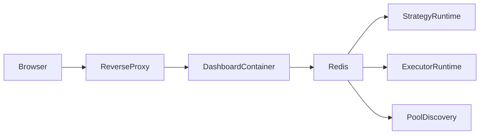

# Dashboard V1 Cockpit

## Information Architecture

This dashboard ships as a single runtime shell with seven hash routes:

- `#dashboard`: high-level PnL, equity curve, active alerts, recent signals, recent trades
- `#markets`: event-derived pool tape, signal markers, pool selector, market context
- `#execution`: open positions, trade ledger, attribution, daily evaluation summaries
- `#strategies`: strategy workflow, shadow cohort quality, operator review queue
- `#replay`: merged timeline and closed shadow record replay surface
- `#risk`: drawdown, cap hits, active alerts, gated panic controls
- `#settings`: security posture, deployment mode, and operational limits

The navigation is intentionally compact and operator-first:

- left rail: status, security, route navigation, operator quick actions
- top bar: route headline and live runtime metadata
- main panels: dense charts, tables, and replay cards instead of widget-heavy admin chrome

## Visual System

The visual system follows the requested high-art dark direction:

- deep black background with restrained radial highlights
- large headline typography and compressed spacing for editorial contrast
- muted monochrome panels with thin lines and rounded geometry
- mono labels for runtime metadata and dense tabular surfaces
- limited accent colors:
  - green for positive PnL and healthy state
  - red for panic / loss / critical
  - amber for warnings
  - blue for overlays and market context

This keeps the dashboard closer to an art-directed terminal than a generic admin template.

## Core Frontend Stack

The implementation stays deployable inside the existing Python dashboard service:

- static shell: `services/dashboard/static/index.html`
- visual system: `services/dashboard/static/styles.css`
- route controller and charts: `services/dashboard/static/app.js`
- market and equity charts: `lightweight-charts` via CDN
- backend aggregation: `services/dashboard/server.py`

This avoids introducing a separate Node runtime into the repo while still enabling a richer cockpit structure.

## Controlled Action Boundary

V1 exposes only a very small write surface:

- acknowledge alert
- review signal as `approved`, `observed`, or `rejected`
- set or clear `SYSTEM_PANIC`

V1 explicitly does not expose:

- manual order placement
- arbitrary strategy parameter edits
- direct execution gateway writes
- Redis / database admin operations

Action safeguards:

- optional Basic Auth for all dashboard routes
- required `X-Dashboard-Action-Token` header for write actions
- optional `DASHBOARD_READONLY=1` kill-switch for the entire action layer
- optional `DASHBOARD_ALLOW_PANIC_ACTIONS=1` gate for panic mutation

## VPS Security Baseline

Recommended runtime posture:

- bind dashboard container to `127.0.0.1`
- place `Nginx` or `Caddy` in front of it
- only expose `80/443` publicly
- enable HTTPS at the reverse proxy
- do not publish Redis, Postgres, ClickHouse, strategy, or executor to the public internet
- keep Basic Auth and action token values in environment variables

Suggested traffic shape:

## New Dashboard Env Vars

The dashboard now supports these environment variables:

- `DASHBOARD_BIND`
- `DASHBOARD_HOST_BIND`
- `DASHBOARD_BASIC_USER`
- `DASHBOARD_BASIC_PASS`
- `DASHBOARD_ACTION_TOKEN`
- `DASHBOARD_READONLY`
- `DASHBOARD_ALLOW_PANIC_ACTIONS`
- `DASHBOARD_MAX_SIGNALS`
- `DASHBOARD_MAX_SHADOW`
- `DASHBOARD_MAX_MARKET_TICKS`
- `DASHBOARD_MAX_MARKET_CANDLES`

## Data Sources Used

The cockpit currently visualizes from these existing runtime surfaces:

- `exec:open_pools` and `exec:pos:*`
- `exec:trades`
- `exec:daily_eval:*`
- `signals` stream
- `shadow:signals`
- `market_ticks` stream
- `pool:discovered:*`
- `SYSTEM_PANIC`

That means the dashboard is already wired to real runtime data rather than demo-only placeholders.
