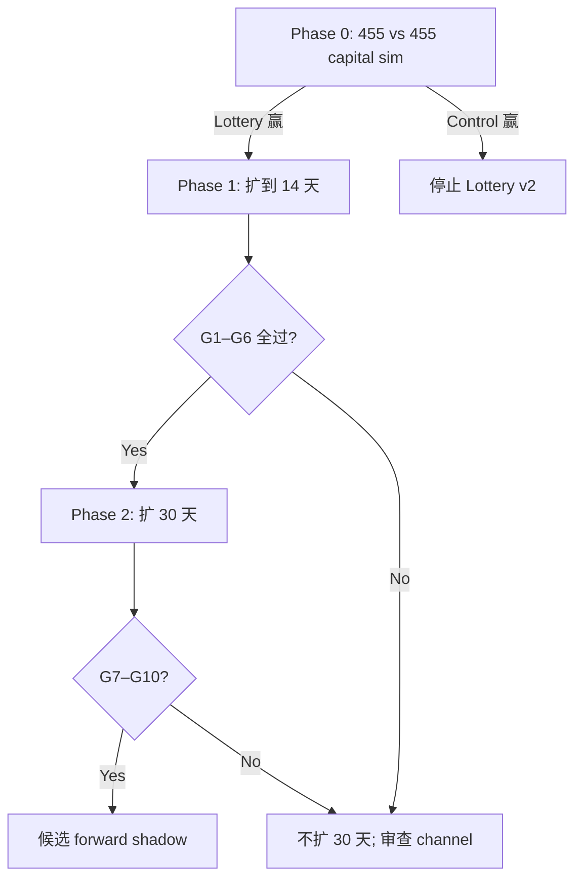

# Lottery v2 数据扩展计划（分阶段）

> **原则**：不一次冲 60 天。先 14 天验证 capital sim 优势是否稳健，再决定是否扩 30 天。
> **规则冻结**：cluster≥0.95 | dev≤50 | T+15→T+90 | 10U | 不调参、不重训。

---

## 当前基线（Phase 0，已完成）

| 项 | 值 |
|----|-----|
| 覆盖日期 | 06-11 ~ 06-15（5 天） |
| Lottery n | 455 |
| Control n | 455（同日 activity-matched） |
| p100 / p300 | Control 更高（9.7% / 4.2% vs 8.4% / 2.6%） |
| Capital sim @0.05% | **Lottery 赢**（med +6.7% vs +1.3%，p5 +3.7% vs +0.9%） |
| drop_top1 @0.05% | Lottery +3.5% vs Control +1.1% |
| Step D n≥1000 | **未达标** |

结论：rate 指标 Control 更好，但 **daily block bootstrap 资金曲线 Lottery 全面更好** → 值得扩样本，但 mega 依赖仍在（drop_top3 → ~0）。

---

## 第一阶段：补到 14 天

### 目标日期

| 批次 | 日期 | 状态 |
|------|------|------|
| 已有 | 06-11, 06-12, 06-13, 06-14, 06-15 | smart_buyers ✓ |
| **优先补** | 06-06, 06-07, 06-08, 06-09, 06-10 | 缓存无 → 新采 |
| **优先补** | 06-16, 06-17, 06-18, 06-19, 06-20 | 缓存无 → 新采 |

**合计 15 个 UTC 日**（5 已有 + 10 新采；用户称「14 天」为近似目标窗口）。

### 样本量目标

```
Lottery n >= 1000
Control n >= 1000
```

按现有 5 天 Lottery 455（~91/天）粗估：14 天 ≈ 1270 Lottery → **可达 1000**。
06-14 单日 223 条说明高活跃日可大幅超标；低活跃日（06-11 仅 19）需靠更多天数补齐。

### 数据采集管线（缓存没有才跑）

```
1. sol_sample_creates   → creates_sample.jsonl     (按日 enumerate + getTransaction)
2. sol_label_features   → creates_labeled.jsonl      (pump.fun API，零 RPC)
3. sol_early_path       → creates_earlypath.jsonl    (bonding curve sig 分页)
4. sol_smart_buyers     → smart_buyers_expand_p1.jsonl (--days MM-DD, day-mode 全采)
5. deployer_history*    → 已有则复用；新 creator 按需补
```

**smart_buyers day-mode**：对目标日 **全采**（非 winner/control 子采样），保证 ex-ante 特征完整。

### 回放管线

```
6. _pump_lottery_v2_frozen_audit.py      → 冻结规则 cohort + matched control + T+15→T+90 replay
7. _pump_lottery_v2_frozen_capital_compare.py → daily block bootstrap 资金曲线
```

### 必跑输出

| 输出 | 内容 |
|------|------|
| `_pump_lottery_v2_frozen_daily.csv` | 按日 Lottery vs Control |
| `_pump_lottery_v2_frozen_readout.md` | aggregate + 按日表 |
| `_pump_lottery_v2_frozen_capital_compare.csv` | 组 × 仓位 × stress |
| `_pump_lottery_v2_expand_gate.json` | Phase 1 过关判定 |

### 必看指标（不是 p100/p300 表格本身）

**Baseline daily block bootstrap，500 笔：**

| 仓位 | 指标 |
|------|------|
| 0.02%, 0.05%, 0.10%, 0.15%, 0.25% | median, p5, p25, p75, p95, MDD p95, ruin |

**Stress @0.05%（daily block）：**

- remove_top1 / top3 / top5
- no_p1000
- halve_mega
- baseline_iid（对照：证明 daily block 必要性）

**核心对比问题：**

1. 0.05% Lottery **median** > Control？
2. 0.05% Lottery **p5** > Control？
3. **drop_top1** 后 Lottery 仍更好？
4. MDD p95 谁更低？

---

## 第一阶段过关标准（→ 才进第二阶段）

**全部满足才扩 30 天：**

| # | 条件 |
|---|------|
| G1 | Lottery n ≥ 1000 且 Control n ≥ 1000 |
| G2 | 0.05% 仓位 Lottery **median** > Control（daily block baseline） |
| G3 | 0.05% 仓位 Lottery **p5** > Control |
| G4 | remove_top1 stress @0.05% Lottery median > Control |
| G5 | Lottery 至少 **3 个不同日期** 有 +300% 以上真实 replay 收益 |
| G6 | +300% 不集中于单日：max-day 占比 ≤ 60%（防单日 mega 撑起） |

**不过则停止扩展**，回到规则/通道审查；不 forward paper。

---

## 第二阶段：14 天仍赢 → 扩 30 天

仅在 Phase 1 gate **PASS** 后执行。

### 目标

- 连续或近连续 30 天（在 Phase 1 14 天基础上向后/向前补）
- Lottery / Control 各 **n ≥ 2000**（或按 RPC 预算调整）
- 重跑同一套：daily table → capital compare → stress tests

### 30 天额外标准

| # | 条件 |
|---|------|
| G7 | 0.05% median / p5 / drop_top1 优势在 30 天样本仍成立 |
| G8 | 至少 **5 个不同日期** 有 +300%（Lottery） |
| G9 | drop_top3 @0.05% Lottery median ≥ 0（理想；非硬性 kill） |
| G10 | ruin @0.10% 仓位 = 0 |

**30 天 FAIL** → Lottery v2 标记为「小样本 channel artifact」，不进入 forward paper。

---

## 执行命令

```bash
cd /opt/EATLQ/scripts/research/sol_grad_audit

# 1. 看缺口（不跑 RPC）
python3 _pump_lottery_v2_expand_replay.py --status

# 2. 补数据（缺日才采；RPC 密集，建议 cgroup）
bash ../base_v4/run_in_cgroup.sh python3 _pump_lottery_v2_expand_replay.py --collect

# 3. 回放 + 分析（可分开）
bash ../base_v4/run_in_cgroup.sh python3 _pump_lottery_v2_expand_replay.py --replay
python3 _pump_lottery_v2_expand_replay.py --analyze

# 4. 全流程
bash ../base_v4/run_in_cgroup.sh python3 _pump_lottery_v2_expand_replay.py --all

# 5. 只看 gate 判定（需已有 audit + capital compare 输出）
python3 _pump_lottery_v2_expand_replay.py --gate
```

---

## RPC 预算粗估（Phase 1 缺 10 天）

| 阶段 | 每币 RPC | 10 天 × ~400 币/天 |
|------|----------|-------------------|
| sample (getTx) | ~1 | ~4,000 |
| earlypath | ~2 | ~8,000 |
| smart_buyers | ~15–25 | ~80,000 |
| frozen replay | ~3 | ~6,000（Lottery+Control 各 ~500 新币） |
| **合计** | | **~100k**（分批跑，checkpoint 续跑） |

---

## 决策树



---

## 文件索引

| 文件 | 用途 |
|------|------|
| `_pump_lottery_v2_expand_replay.py` | 编排：采集 / 回放 / gate |
| `_pump_lottery_v2_frozen_audit.py` | 冻结 cohort + replay |
| `_pump_lottery_v2_frozen_capital_compare.py` | daily block bootstrap |
| `_pump_lottery_v2_expand_gate.json` | Phase 1/2 判定输出 |
| `mvp/diagnostics/sol/smart_buyers_expand_p1.jsonl` | Phase 1 新采 smart_buyers |

---

## 不做的事

- ❌ 不重训 ex-ante 模型
- ❌ 不调 cluster/dev 阈值
- ❌ 不碰 live executor
- ❌ Phase 1 不过就扩 30 天
- ❌ 不用 iid bootstrap 作最终结论（仅作对照）
