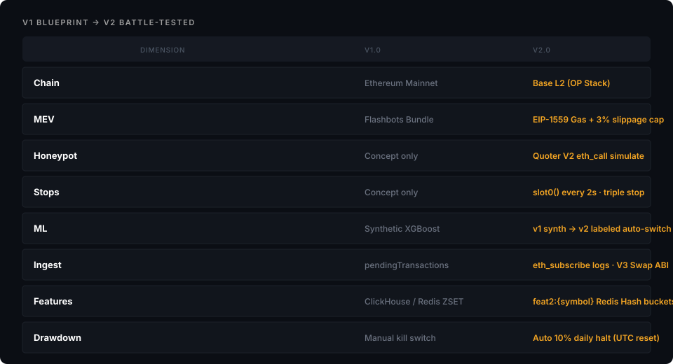

# LASZLO v1：战前蓝图与被现实推翻的假设

> Agent archive: body text + figure transcriptions (tables/flows). Prefer this file over copying images into context.
> Source: https://www.wisdomechoes.net/blog/laszlo-whitepaper-v1
> Also: `FIGURES.md` · offline HTML `../www.wisdomechoes.net/blog/laszlo-whitepaper-v1.html`

[← articles](https://www.wisdomechoes.net/articles)Crypto·Jun 29, 2026·11 min read

# LASZLO v1：战前蓝图与被现实推翻的假设

v1 不是当前架构说明，而是一张战前地图：Mainnet、Flashbots、ClickHouse、钱包画像和 100M AUM 叙事都画得很完整。真正开工后，现实保留了原则，推翻了大部分路径。

Franklin Nexus

### Figure: V1 Cover


> Decorative cover. No readable text/tables.
>
> Visual: neon "A"/pulse logo; abstract dashboard; circuit floor nodes.

LASZLO Project Whitepaper v1.0

>

历史文档：LASZLO 当前实现与状态请读 [v2 实战修订版](https://www.wisdomechoes.net/blog/laszlo-whitepaper-v2)。本文保留 v1，是为了记录一个系统在接触真实链、真实数据和真实资金之前，会怎样高估自己。

v1 写于系统真正运行之前。它有 Ethereum Mainnet、Flashbots、ClickHouse、PostgreSQL、钱包画像、XGBoost、动态仓位和自动风控，甚至写下了「承载 100M AUM 逻辑」的目标。

架构看起来完整，是因为每个未知数都被一个组件名填上了。

真正开工以后，我才发现：组件之间能画出箭头，不等于数据能流过去；模型能输出概率，不等于概率能赚钱；执行器能发交易，更不等于它应该发交易。

这篇文章不再重复旧白皮书，而是回答三个问题：当时为什么那样设计，哪些原则活了下来，哪些假设被现实推翻。

### Figure: V1 Blueprint → V2 Battle-tested



**V1 BLUEPRINT → V2 BATTLE-TESTED**

| Dimension | V1.0 | V2.0 |
|-----------|------|------|
| Chain | Ethereum Mainnet | Base L2 (OP Stack) |
| MEV | Flashbots Bundle | EIP-1559 Gas + 3% slippage cap |
| Honeypot | Concept only | Quoter V2 eth_call simulate |
| Stops | *(row incomplete in SVG; v2 has)* | slot0() every 2s · triple stop |
| ML | Synthetic XGBoost | v1 synth → v2 labeled auto-switch |
| Ingest | pendingTransactions | eth_subscribe logs · V3 Swap ABI |
| Features | ClickHouse / Redis ZSET | feat2:{symbol} Redis Hash buckets |
| Drawdown | Manual kill switch | Auto 10% daily halt (UTC reset) |

v1 蓝图 vs v2 实战

## 1. v1 想解决什么

当时的直觉并不复杂：链上市场公开、可编程、结算透明，但散户工具彼此割裂。一个人在浏览器里看钱包，在图表网站看价格，再去 DEX 下单。信息、判断、执行和复盘没有同一份上下文。

LASZLO 想把它们接成一个闭环：

```text
链上事件
  → 清洗与特征
    → 概率判断
      → 风控后的执行
        → 成交与结果回写
          → 下一轮训练
```

这个目标一直没有变。v1 的问题不在闭环方向，而在于它把闭环里每一段最理想的实现，当成了第一版必须同时完成的前提。

## 2. 当时的四层架构

v1 把系统分成四层：

层设计当时的理由感知Rust WebSocket Ingestor链上事件需要稳定、低延迟地进入系统传输Redis Streams解耦采集、策略和执行，允许独立失败记忆ClickHouse + PostgreSQL分开处理历史分析与业务状态大脑与界面Python + Streamlit快速做特征、模型和监控

这套分层大体成立。Rust 处理 IO 和执行，Python 处理研究，Redis 作为消息总线，也一直保留到了 v2。

但 v1 同时加入了过多尚未需要的能力：全量钱包画像、冷热双存储、完整前端、Flashbots 私有执行、自动重训和多套数据库。每个组件都合理，组合在第一阶段却让验证路径变长。

我当时以为「先把机构级地基打牢，再写策略」叫慢即是快。后来才明白，若最关键的不确定性是有没有 edge，先把地基做得更重，只是在更昂贵地等待答案。

## 3. 五个被推翻的假设

### 3.1 主战场必须是 Ethereum Mainnet

v1 默认 Mainnet 流动性最好，也因此围绕 Flashbots 和公共内存池设计执行。实战转向 Base L2，原因不是 Base 更「高级」，而是实验成本更低：小额交易、频繁回放和故障复现都不需要先支付昂贵 Gas。

这也改变了 MEV 模型。Base 由 Sequencer 排序，传统 Flashbots Bundle 并不直接适用。执行保护转向滑点上限、Gas 异常熔断、交易模拟和更保守的开仓门禁。

### 3.2 历史数据库是实时闭环的前提

ClickHouse 很适合大规模分析，但第一阶段的真正需要只是：把候选信号、当时特征和事后结果可靠地留下来。

在 8GB WSL2 环境里，ClickHouse 增加了资源压力，却没有回答 edge 是否存在。v2 暂停它，用 `dashcam.csv`、标注表和事件账本完成离线闭环。数据库可以以后加，错误的问题无法靠数据库修好。

### 3.3 先完成钱包画像，策略才有价值

v1 把 Smart Money、Sniper、Diamond Hand 等标签写成核心护城河。但实体聚类、历史盈亏和跨地址归因本身就是独立研究项目，且很容易产生错误确定性。

v2 先从可直接观察的资金流、活跃度和波动代理开始，保留钱包画像接口，却不再让它阻塞整个系统。先建立可回放闭环，再决定哪种画像值得付出成本。

### 3.4 模型分数可以直接解释成胜率

v1 写下 `Model_Score = 0.87`，仿佛模型输出天然是 87% 的盈利概率。现实里，标签定义、时间切分、类别不平衡、阈值选择和市场 regime 都会改变这个数字的含义。

v2 使用时间 holdout 和明确部署门禁。模型没有通过样本外检验，就不能因为线上需要「有交易」而降低阈值。零交易是一个合法结果。

### 3.5 资金规模可以先按未来目标设计

v1 用 5,000 或 20,000 美元举例动态仓位，目标又写到 100M AUM。实际测试钱包只有约 25 美元。

这不是一个尴尬细节，而是一条重要纪律：仓位、滑点、Gas 和收益结构都必须从真实本金倒推。用未来规模描述今天的系统，会让风险参数和经济模型一起失真。

## 4. 哪些原则活了下来

### 单一链上出口

只有 Rust Executor 能发送 swap。策略、止损和其他服务只能写信号，不能各自持有一条通往 Router 的路径。这样才可能做幂等、对账和统一急停。

### BUY 保守，SELL 逃生

开仓时，余额、链头、流动性、回撤或 RPC 状态不确定，都应该拒绝交易；平仓时应尽量避免因为同样的不确定性把资金困住。两者不是对称操作。

### 账本是真源

界面、Redis 当前状态和模型日志都可能丢失或被覆盖。每笔交易必须有可以重放的事件链，记录意图、提交、回执、持仓和退出。

### 研究与执行分离

Python 可以快速修改标签、特征和模型；Rust 执行器只接受稳定的信号契约。研究代码不应该因为一次 notebook 修改就获得移动资金的权限。

### 系统必须能够拒绝服务

模型 schema 不一致、链 ID 错误、私钥格式异常、风险状态未知，都应该让服务停下来。对交易系统而言，拒绝运行往往比带病运行更接近正确。

## 5. v1 最大的错误不是技术选型

它最深的错误，是把「系统完整」当成「命题成立」。

一套交易系统至少有三层不同的成功：

- 数据和消息能够稳定流动；

- 交易能够被正确执行、退出和复盘；

- 策略扣除摩擦后仍有正期望。

v1 把三层写成了一件事，好像完成前两层就会自然得到第三层。实际上，前两层只是让第三层拥有了一个诚实的实验环境。

工程不会产生 Alpha。它只能让一个存在的 edge 被兑现，也让一个不存在的 edge 更快暴露。

## 6. 为什么还保留这份蓝图

删除 v1 会让 v2 看起来像一开始就知道答案。事实不是这样。

MsgPack 格式错过，特征值爆炸过，止损曾经读取占位价格，Mainnet 和 Flashbots 的叙事也确实写得很兴奋。系统后来的克制，来自这些具体错误，而不是一种与生俱来的架构品味。

历史版本的价值，不是供人继续照着部署，而是保留判断发生变化的证据。

如果今天重新开始，我仍会选择 Rust、Python 和 Redis，但会把第一阶段压得更窄：

```text
一条链
→ 一种池
→ 一个可解释标签
→ 一份可回放日志
→ 一套时间 holdout
→ 一个永远不能被叙事绕过的部署门禁
```

先证明问题值得做，再让架构长大。

## 结语

v1 是一张画得过于完整的地图。它保留了方向：低延迟、闭环、风控和单兵垂直整合；现实则重新绘制了道路：Base、Redis、事件账本、样本外门禁和允许零交易。

我不再把「机构级」理解为组件多、延迟低或界面像终端。更接近机构级的东西，是系统知道自己不知道什么，并且在证据不足时真的不会下单。

[previousLASZLO v2：一个能拒绝交易的链上量化系统](https://www.wisdomechoes.net/blog/laszlo-whitepaper-v2)[all articles →](https://www.wisdomechoes.net/articles)
