# LASZLO v2：一个能拒绝交易的链上量化系统

> Agent archive: body text + figure transcriptions (tables/flows). Prefer this file over copying images into context.
> Source: https://www.wisdomechoes.net/blog/laszlo-whitepaper-v2
> Also: `FIGURES.md` · offline HTML `../www.wisdomechoes.net/blog/laszlo-whitepaper-v2.html`

[← articles](https://www.wisdomechoes.net/articles)Crypto·Jun 29, 2026·18 min read

# LASZLO v2：一个能拒绝交易的链上量化系统

工程闭环已经成立，Alpha 还没有。LASZLO v2 把链上采集、时间标注、样本外门禁、统一执行和事件账本接成一条可证伪的路径，并允许最诚实的结果是 0 BUY。

Franklin Nexus

### Figure: Cover · Pulse Channel


> Decorative cover. No readable text/tables.
>
> Visual: dark tech scene; golden stylized "A"/pulse logo; floating dashboard (line/bar/donut charts); Bitcoin-node pedestals on a grid.

LASZLO Project Whitepaper v2.0

LASZLO v2 已经能完成一笔链上交易系统该做的工程工作：监听 Base 上的 Swap，计算特征，生成信号，在 Anvil 或主网执行，追踪持仓，触发退出，再把事件写进可复盘账本。

它还没有证明一件更重要的事：这些信号能稳定赚钱。

这两个结论必须同时写在开头。只写前者，是把工程能力冒充 Alpha；只写后者，又会忽略一个可靠实验环境本身的价值。

### Figure: Research Discipline

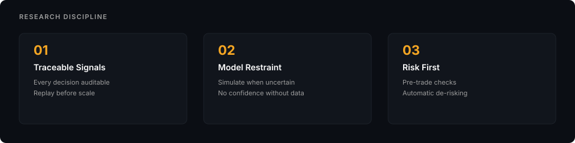

**RESEARCH DISCIPLINE**

| # | Pillar | Meaning |
|---|--------|---------|
| 01 | Traceable Signals | Every decision auditable; Replay before scale |
| 02 | Model Restraint | Simulate when uncertain; No confidence without data |
| 03 | Risk First | Pre-trade checks; Automatic de-risking |

研究纪律：可追溯、克制、风控优先

v2 的核心不再是「更快地下单」，而是让一个交易命题经过完整、可重放、不能绕过的检验：

```text
ingest
  → label
    → train
      → holdout gate
        → paper / live
          → ledger
            → diagnose or stop
```

### Figure: LASZLO Iteration Loop (Phase 6 RL-style)

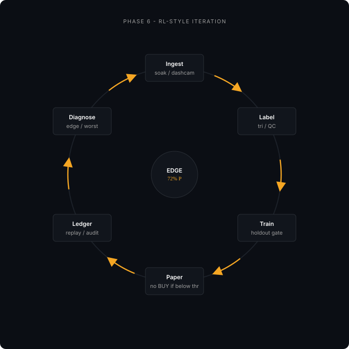

**PHASE 6 — RL-STYLE ITERATION** (center gate: EDGE / 72% P)

```text
Ingest (soak / dashcam)
  → Label (tri / QC)
    → Train (holdout gate)
      → Paper (no BUY if below thr)
        → Ledger (replay / audit)
          → Diagnose (edge / worst)
            → (loop back)
```

LASZLO 迭代闭环

## 1. 系统究竟解决什么

链上市场不是缺数据。真正稀缺的是一条不会在中途偷换定义的证据链。

散户工具通常把流程拆开：一个页面看钱包，一个页面看价格，另一个页面下单，最后靠记忆解释盈亏。模型团队也容易把训练指标、模拟收益和真实执行混在一起，只要其中一个数字好看，就说策略有效。

LASZLO 想做的是另一件事：每个候选信号必须带着当时的特征、模型版本、阈值和市场状态进入账本，之后再用统一标签回看。策略不能只展示成功样本，执行器也不能在失败后悄悄重发一笔无法区分的新交易。

### Figure: Retail Status Quo vs LASZLO

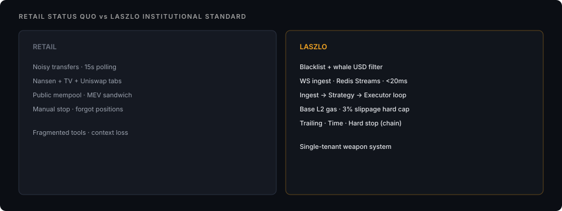

**RETAIL STATUS QUO vs LASZLO INSTITUTIONAL STANDARD**

| Dimension | RETAIL | LASZLO |
|-----------|--------|--------|
| Data filter | Noisy transfers · 15s polling | Blacklist + whale USD filter |
| Ingest latency | (tabs / polling) | WS ingest · Redis Streams · 零售工具割裂与闭环系统

系统边界很窄：

- 主战场是 Base L2 上的 DEX 现货；

- 主要观察 Uniswap V3 事件；

- 单租户、单机 Docker Compose；

- Rust 负责采集和执行，Python 负责研究与策略；

- 不做 CEX 合约、跨链套利或大众 SaaS；

- 没有通过门禁的模型不能获得真实 BUY 权限。

## 2. 72% 不是信仰，是一条经济门禁

早期量化直觉常说「胜率超过 55% 就能试」。这句话忽略了赔率、滑点、Gas、MEV、机会成本、策略衰减和资本成本。

LASZLO 用 `precision_economics.py` 把这些假设显式写出来。按当时 Base 小额交易的收益与摩擦结构，模型需要在选定阈值上达到约 72% precision，才有机会覆盖成本并留下正期望。

这不是加密市场的宇宙常数。赔率分布、仓位和摩擦改变，门槛也会改变。它的价值在于：部署标准由经济约束倒推，而不是由「系统最近很久没交易了」倒推。

因此：

- 分布质检通过，不等于模型通过；

- 验证集好看，不等于时间 holdout 好看；

- 降低阈值换来几笔 BUY，不等于策略变强；

- `0 BUY` 可以是系统正确执行门禁的结果。

### Figure: Alpha vs Beta (conceptual)


> Decorative split panel. No readable text/tables.
>
> Left (gold): waveform → network/graph nodes (signal / model side).
> Right (teal): candlestick chart + icons (people / database / institution) — market & beta context.

Alpha 与 Beta

这里还要区分 Alpha 与 Beta。模型可能在某个市场阶段识别得不错，但 Base meme 池整体流动性收缩，账户仍然会输。选链、选池和选时间本身就是 Beta 决策，不能假装策略运行在真空里。

## 3. 架构：让每层只做一件事

### Figure: Hybrid Architecture

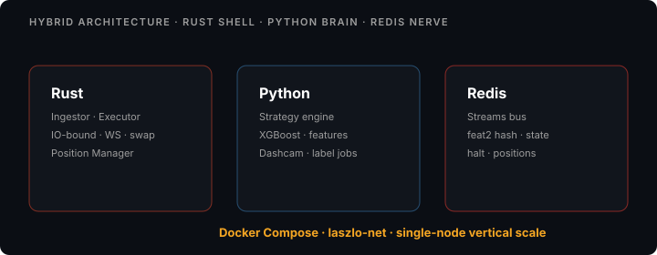

**HYBRID ARCHITECTURE · RUST SHELL · PYTHON BRAIN · REDIS NERVE**

| Layer | Components | Role |
|-------|------------|------|
| Rust | Ingestor · Executor · Position Manager | IO-bound · WS · swap |
| Python | Strategy engine · Dashcam · label jobs | XGBoost · features |
| Redis | Streams bus · feat2 hash · state | halt · positions |

Footer: Docker Compose · laszlo-net · single-node vertical scale

LASZLO 异构架构

当前主路径如下：

```text
Alchemy WS / HTTP
  → Rust Ingestor
    → Redis Streams: market_ticks
      → Python Strategy Engine
        → Redis Streams: signals
          → Rust Executor
            → Anvil fork / Base Mainnet
              → trade_ledger.jsonl
```

### Figure: LASZLO Data Pipeline

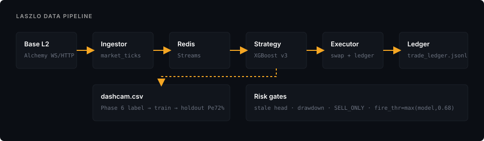

**LASZLO DATA PIPELINE**

```text
Base L2 (Alchemy WS/HTTP)
  → Ingestor
    → market_ticks (Redis Streams)
      → Strategy (XGBoost v3)
        → Executor (swap + ledger)
          → Ledger: trade_ledger.jsonl + dashcam.csv
```

- Phase 6: label → train → holdout · Pe ≥ 72%
- Risk gates: stale head · drawdown · SELL_ONLY · `fire_thr = max(model, 0.68)`

LASZLO 数据管线

### 3.1 Ingestor：无状态的耳朵

Ingestor 订阅链上日志，解码事件，补齐池和代币信息，再把 `MarketTick` 以 MsgPack 写入 `market_ticks`。它不判断策略，不管理止损，也不直接发 `signals`。

这个边界很重要。采集服务一旦开始「顺手」做决策，故障恢复、重放和数据审计都会失去清楚语义。

Rust 与 Python 之间曾经因为 MsgPack 结构出过一个典型错误：`to_vec()` 把 struct 编成 Array，Python 却期待 Map。管道看起来在线，策略端实际无法读取。后来改为 `to_vec_named()`，并把跨语言契约加入启动检查。

### 3.2 Redis Streams：消息总线，不是真相本身

`market_ticks` 承载原始行情，`signals` 承载交易意图。Consumer Group 提供 at-least-once 语义：服务处理完成后才 `XACK`，崩溃后消息可以重新领取。

这意味着重复投递是系统特性，不是异常。因此交易端必须幂等。每个 SELL 意图带 `intent_id`，通过 Redis `SET NX` 取得处理权；交易提交后只按 tx hash 轮询 receipt，不能因为 RPC 暂时无响应就重发同一笔交易。

Redis 当前状态可以被覆盖，所以它不是复盘真源。单笔交易的最终事实保存在 `trade_ledger.jsonl` 事件链里。

### 3.3 Strategy：只负责提出 BUY

策略引擎消费 tick，更新 `feat2:{symbol}` 时间分桶，计算资金流、买压、波动代理和活跃度，再由模型输出候选分数。

它只允许发布开仓 BUY。平仓由 Position Manager 根据持仓状态写 SELL 信号，仍然经过统一 Executor。这样所有链上出口只有一个，风险和对账逻辑不会分叉。

### 3.4 Executor：唯一能移动资金的组件

Executor 消费 `signals`，完成链 ID、私钥、余额、风险状态、流动性和卖出可行性检查，再通过 Uniswap Router 构建并发送交易。

Paper 模式连接 Base fork 上的 Anvil；Live 模式连接 Base Mainnet。模式切换不是一个界面按钮，而是一组必须同时满足的配置与门禁。

### Figure: Infrastructure Stack v2

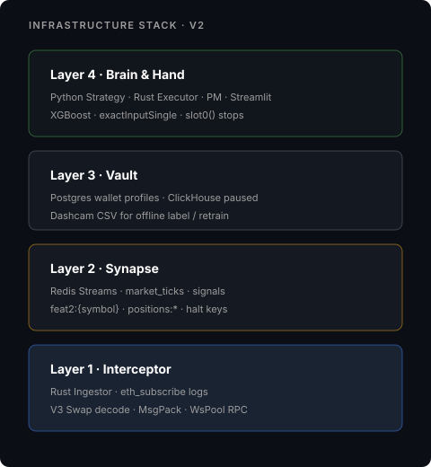

**INFRASTRUCTURE STACK · V2**

| Layer | Name | Contents |
|-------|------|----------|
| 4 | Brain & Hand | Python Strategy · Rust Executor · PM · Streamlit; XGBoost · exactInputSingle · slot0() stops |
| 3 | Vault | Postgres wallet profiles · ClickHouse paused; Dashcam CSV for offline label / retrain |
| 2 | Synapse | Redis Streams · market_ticks · signals; feat2:{symbol} · positions:* · halt keys |
| 1 | Interceptor | Rust Ingestor · eth_subscribe logs; V3 Swap decode · MsgPack · WsPool RPC |

基础设施分层

## 4. 一条 tick 如何穿过系统

### Figure: Base L2 Execution (isometric)


> Decorative isometric diagram. No readable text/tables.
>
> Flow metaphor: input node → layered data stack (Uniswap/unicorn + AI/robot) → cluster cylinders → green shield gates → dispersed output.

Base L2 执行透视

一笔 Uniswap V3 Swap 被节点推送后，Ingestor 解码日志并写入 Redis；Strategy 读取 tick、更新特征、打分；只有高于部署阈值的信号才进入 `signals`；Executor 完成预交易检查后，才可能在 Anvil 或 Base 上提交。

### Figure: Tick Lifecycle Timeline

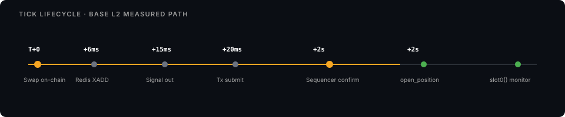

**TICK LIFECYCLE · BASE L2 MEASURED PATH**

| Time | Event |
|------|--------|
| T+0 | Swap on-chain |
| +6ms | Redis XADD |
| +15ms | Signal out |
| +20ms | Tx submit |
| +2s | Sequencer confirm |
| after | open_position · slot0() monitor |

Tick 生命周期

毫秒数字不是核心承诺。节点、缓存和链状态会改变延迟。真正需要稳定的是事件顺序和失败语义：哪一步失败，消息是否确认，资金是否移动，下一次恢复从哪里开始。

v1 曾把「T+20ms 执行」写得像性能合同。v2 更关心另一类问题：如果 T+17ms 时 RPC 结果不确定，系统会不会错误开仓；如果交易已经提交但 receipt 暂时读不到，会不会重复发送。

## 5. 模型闭环：先保证不能骗自己

### Figure: ML Loop · Signal to Deployment

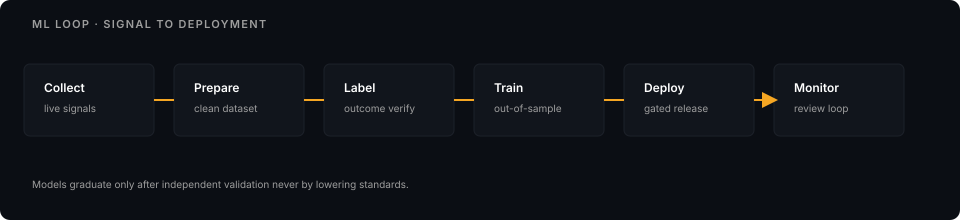

**ML LOOP · SIGNAL TO DEPLOYMENT**

| Step | Action |
|------|--------|
| Collect | live signals |
| Prepare | clean dataset |
| Label | outcome verify |
| Train | out-of-sample |
| Deploy | gated release |
| Monitor | review loop |

> Models graduate only after independent validation — never by lowering standards.

机器学习流水线

离线链路分为五步：

- Strategy 把候选信号与特征快照写入 `dashcam.csv`；

- 清洗脚本生成统一 cohort；

- 标注脚本根据事后价格路径生成标签；

- 训练脚本按时间切分，最新七天作为固定 holdout；

- 只有 precision、样本量、AUC、gap 等门禁同时通过，才写出可部署模型与 manifest。

模型 manifest 记录 active features 及顺序。Strategy 启动时检查权重维度、特征 schema 和 manifest，一旦不一致就拒绝服务。比起让模型「先跑起来再说」，拒绝启动更安全。

### 5.1 标签比模型更值得怀疑

模型差不一定因为算法弱。可能是标签问题问错了、样本只覆盖单一 regime、收益窗口与真实执行不一致，或训练特征和线上特征没有同一种语义。

LASZLO 已经遇到过训练与线上漂移：训练侧某些滚动统计来自标注后的价格变化，线上却用 tick 资金流代理。字段名字相似，不代表分布和含义相同。

因此每次 exit=2 不再只触发「再调一次参数」，还要进入 edge diagnosis：分别检查标签、regime、特征、运行时和整个交易命题是否问错。

### 5.2 自动重训不能自动部署真理

自动化适合完成采集、标注和报告，不适合在指标边缘时替人解释证据。新模型可以自动生成，但不能只因为比旧模型高一点就获得资金权限。

复利不会区分正确与错误。一个自动重训系统如果奖励函数错了，只会更稳定地放大错误。

## 6. 风控：BUY 与 SELL 不对称

### Figure: BUY vs SELL Asymmetry

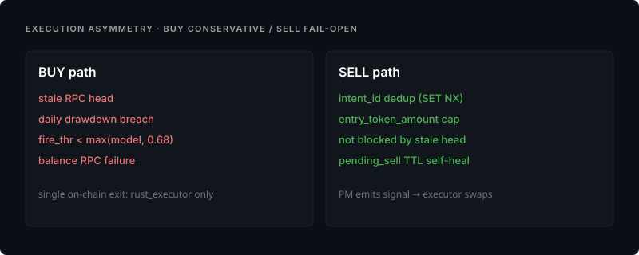

**EXECUTION ASYMMETRY · BUY CONSERVATIVE / SELL FAIL-OPEN**

| BUY path (fail-closed triggers) | SELL path (fail-open) |
|--------------------------------|------------------------|
| stale RPC head | intent_id dedup (SET NX) |
| daily drawdown breach | entry_token_amount cap |
| fire_thr BUY 保守，SELL 逃生

开仓创造新的风险，平仓减少已有风险。因此两者不能使用同一套失败策略。

### BUY fail-closed

以下任一状态不确定，系统都拒绝新开仓：

- 链头过旧或 RPC 无法确认；

- `SYSTEM_PANIC` 或回撤停买已触发；

- ETH / WETH 余额读取失败；

- 流动性不足，或 Quoter 无法证明代币可以卖出；

- 模型、manifest 或特征 schema 不一致；

- Gas 或滑点超过硬上限。

拒绝一笔可能赚钱的交易，只损失机会；错误开仓可能损失本金。

### SELL 尽量 fail-open

SELL 不应该因为 stale head、日回撤或开仓门禁被挡住。系统使用持仓记录中的 token amount 上限，避免误扫钱包其他余额；若交易 receipt 明确 `status=0`，才解除锁并重新产生退出意图；若状态无法判定，则延长锁，避免重复卖出。

### 三重退出

### Figure: Triple Stop Loss

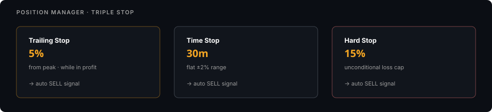

**POSITION MANAGER · TRIPLE STOP**

| Stop | Param | Rule |
|------|-------|------|
| Trailing Stop | 5% | from peak · while in profit → auto SELL signal |
| Time Stop | 30m | flat ±2% range |
| Hard Stop | 15% | unconditional loss cap |

三重止损

Position Manager 根据链上报价维护峰值和持仓时间：

- Trailing Stop：从峰值回撤约 5%；

- Time Stop：约 30 分钟后动量消失；

- Hard Stop：亏损达到约 15%。

这些数字是当前策略参数，不是普遍最优值。重要的是它们由统一状态机执行，并在账本里留下触发原因。

## 7. Base L2 改变了什么

v1 围绕 Ethereum Mainnet 和 Flashbots 设计。v2 迁移到 Base，主要为了降低实验成本和提高小额测试密度。

Base 的 Sequencer 结构让传统 Flashbots Bundle 不再是直接答案。当前保护来自 EIP-1559 参数、滑点硬上限、Gas 异常熔断、Quoter 模拟和更保守的信号门禁。

低 Gas 不代表低风险。小市值池的流动性、代币行为和 RPC 数据质量仍然可能让一笔「便宜交易」变成昂贵错误。

## 8. 四个真实故障

### MsgPack 结构错了

Rust 输出 Array，Python 期待 Map。服务都在运行，数据却没有真正进入策略。跨语言契约后来改成显式测试，而不是靠双方「看起来兼容」。

### 特征值爆炸

早期 `price_velocity_5m` 用原始 token 数量推价格，小数位一变化就出现天文数字。后来改用 `net_flow / abs_flow` 作为有界方向代理。名字没那么漂亮，但语义更稳定。

### 止损读取占位价格

Position Manager 曾经写着 `current_price = entry_price`。系统能开仓，止损条件却永远不可能触发。涉及资金安全的 TODO 不应该返回一个「暂时合理」的值，而应该直接让构建或启动失败。

### 日回撤把不确定余额当成零

RPC 读数失败时，如果把余额默认成零，系统会制造一次虚假巨额回撤。现在读数不确定就跳过本轮检查，不写入错误风险状态；同时综合 ETH、WETH 和未平仓状态，避免把资产形态变化误认成亏损。

这些故障没有一件来自高深算法。交易系统最先伤人的，往往是序列化、单位、占位符和失败默认值。

## 9. 当前 honest 状态

### Figure: Delivery Roadmap

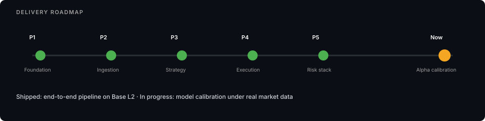

**DELIVERY ROADMAP**

| Phase | Name | Status signal |
|-------|------|---------------|
| P1 | Foundation | shipped path |
| P2 | Ingestion | shipped path |
| P3 | Strategy | shipped path |
| P4 | Execution | shipped path |
| P5 | Risk stack | shipped path |
| Now | Alpha calibration | in progress |

> Shipped: end-to-end pipeline on Base L2 · In progress: model calibration under real market data

LASZLO 当前路线图

本文重写所依据的 2026 年 6 月快照是：

- 实时采集、信号、Paper 执行、持仓退出和账本闭环已存在；

- dashcam 时间跨度约 29 天，继续向 60 天 regime 覆盖累积；

- 一轮分布 QC 通过，但这只证明样本形式可用；

- 最新时间 holdout precision 远低于 72% 门禁，验证集最佳值也不足以部署；

- 线上保持 0 BUY 预期，不通过降低阈值制造交易；

- edge 稀缺和标签 / regime 问错两种解释都仍然成立。

状态会继续变化，当前值应以仓库里的 readiness、metrics 和 ledger 为准。这里保留的是写作时的事实，不把它冻结成永远的项目宣传。

## 10. 下一步不是继续堆功能

当执行闭环已经可用，继续增加 dashboard、数据库或策略名称的边际价值很低。真正需要回答的是：在足够长、足够多样的市场 regime 上，是否存在一个扣除摩擦后仍可部署的 edge。

接下来的动作只有三类：

- 增加有效证据：继续采集、检查标签质量和时间覆盖；

- 做有方向的证伪：ablation、周切片、标签变体、执行摩擦与衰减测试；

- 准备停止或 pivot：若 span 满足而 holdout 仍失败，停止增量 RPC 与 live 计划，转向更适合当前数据和执行能力的问题。

「已经写了很多代码」不是继续交易命题的理由。工程资产可以迁移，错误命题不需要被忠诚地维护。

## 结语

LASZLO v2 证明了什么？它证明一名 Builder 可以把链上采集、模型研究、Rust 执行、风险状态和复盘账本接成一个真实运行的系统。

它还没有证明什么？它没有证明当前标签和特征拥有可部署 Alpha，也没有证明代码量、低延迟或复杂架构能自动换来收益。

我现在更看重后一个结论。一个交易系统真正成熟的标志，不是它随时能开枪，而是它知道瞄准镜没有校准时，扳机应该被锁住。

[nextLASZLO v1：战前蓝图与被现实推翻的假设](https://www.wisdomechoes.net/blog/laszlo-whitepaper-v1)[all articles →](https://www.wisdomechoes.net/articles)
